## At a Glance

## Introduction
Developing a high-quality measure of a latent construct requires evidence on how well the measure, a scale or a test, works.
Applied researchers most often gather this evidence using factor analysis [for a tutorial on how to do this in R, see @xxx].
Factor analysis answers important questions: whether the items reflect a common latent variable, how well the model reproduces the observed associations among the items, and how strongly each item is related to the latent variable.

There is, however, an important aspect of measurement that typical applications of factor analysis do not address: how informative the scale is at different levels of the latent variable, that is, how precisely it measures respondents at these levels, and which items are informative in which range.
One reason for this is that factor analysis is often applied with a linear model that treats item responses as continuous, which implies that measurement precision is the same at all levels of the latent variable.
Even when researchers use factor-analytic models for categorical data, which could in principle address it, this aspect is rarely examined.
Item response theory (IRT), a family of models for categorical item responses, puts it at the center of the analysis.^[The most popular IRT models are closely related to factor-analytic models for categorical data [@takaneRelationshipItemResponse1987]. The difference between the two approaches therefore lies less in the statistical models themselves than in how they are used.]

To see why varying informativeness matters, consider a test of mathematical proficiency. Imagine that the test is so difficult that most students score zero and only the scores of the most proficient students vary. The test then provides information only about these students: we can tell how their proficiency differs. About all other students, it provides no information: they all score zero, so we cannot distinguish between them, and they appear to have the same level of proficiency even though their actual proficiency may differ considerably. This is a problem not only for inferences about the distribution of proficiency in the target population but also for estimating associations with other variables: because the scores of a large part of the sample do not vary, they cannot covary with other variables either, which distorts the estimated associations. The issue is not limited to cognitive measures; it applies equally to other kinds of measures, such as attitude scales [@kocConstructingMeasuresSocial2026]. 

Varying informativeness is not the only thing IRT brings into view. Because it places items and respondents on the same scale, a respondent's position on the latent variable can be interpreted in terms of content: which statements they are likely to agree with and which they are not. The same item-level logic extends to further questions that matter in scale development: whether the response categories of items with more than two categories work as intended, whether items function in the same way across groups of respondents (differential item functioning, DIF), and which items to keep when a scale has to be shortened. 

In this tutorial, we introduce IRT from the perspective of measure construction and show how IRT-based reasoning guides the researcher through the process of scale development, from item generation to scale validation. We begin by explaining the motivation for IRT and how it differs from classical test theory.


### Motivation for IRT and differences from classical test theory

In the social sciences, the constructs we want to measure, such as attitudes or personality traits, usually cannot be observed directly. We therefore operationalize them using instruments such as scales.
This creates a gap between two levels: the latent level, at which the constructs of interest are located, and the manifest level, at which we observe responses to items.
To bridge this gap, we need a description of how the observed responses relate to the latent construct.
Such a description is called a *psychometric model*.

Put simply, a psychometric model describes how likely a given response is, depending on quantities that cannot be observed directly.
To build such a model, we first need to ask what determines how a person responds to an item.
Two things come to mind:

1.  The person: their level on the latent variable we want to measure

2.  The item: its own properties, which are the same regardless of who answers it

For example, one would expect that the more environmentally concerned a person is (the construct we use as a running example throughout this tutorial), the more likely they are to agree with an item that advocates stronger climate protection measures.
At the same time, the characteristics of the item also influence how respondents answer it, such as how clearly it is worded or how difficult it is to agree with.

IRT models both of these influences explicitly.
This is the fundamental difference from classical test theory (CTT) [@wilsonConstructingMeasuresItem2023, p. 139].
CTT is defined at the level of the total score, which it decomposes into a true score and an error, so the properties of the items do not appear in the model.
Item statistics such as difficulty (the proportion of endorsed responses) and item-total correlations can be computed, but they are descriptive and not parameters of the model itself.
IRT, by contrast, models the response of each person to each item.
The model contains two kinds of parameters: a person parameter, which describes the person's level on the latent variable and is the same for all items the person answers, and item parameters, which describe the properties of an item, such as its difficulty, and are the same for all persons who answer it.

This difference has several consequences for scale development [for a detailed discussion, see @embretson_item_2025, pp. 10-41].
First, CTT assigns a single standard error of measurement, derived from the reliability of the scale in a given population, to all scores, whereas in IRT precision varies across the latent variable, as discussed above.
Second, a total score in CTT obtains its meaning from a comparison with other respondents, whereas a position on the IRT scale can also be interpreted in relation to the items.
Third, CTT item statistics depend on the sample: the same item appears easier in a sample with high levels of the latent variable than in a sample with low levels, whereas IRT item parameters are, in principle, comparable across such samples.
Fourth, total scores can be compared directly only when respondents answered the same items, whereas IRT scores based on different sets of items are comparable as long as the item parameters are known.
These advantages hold only to the extent that the assumptions of the model are met.

## Running example: Environmental Concern scale

In this tutorial, we use the *Environmental Concern scale* (ECo scale) developed by @gommHowMeasureEnvironmental2026 as a running example.
The authors observe that existing measures of environmental concern do not capture high levels of concern well, so that respondents with high levels are measured imprecisely.
They evaluate the items of three established scales with IRT and combine the best-performing ones into a new scale that measures more precisely at high levels of environmental concern.

The [data](https://doi.org/10.7910/DVN/ZMQRIH) from this study are publicly available, so you can download them and follow along with the code examples.

**The ECo scale consists of the following nine items:**

Instruction: *What do you think about the following statements and questions?*

| Item | Item text |
|------------------------------------|------------------------------------|
| 1 | I am worried when thinking about the environmental conditions in which our children and grandchildren are likely to live. |
| 2 | If we continue in the same way, we are heading towards an environmental disaster. |
| 3 | We worry too much about the future of the environment and not enough about prices and jobs today. |
| 4 | At present, the majority of the population in our country is still not acting in a very environmentally conscious way. |
| 5 | In my opinion, environmentalists strongly overstate the significance of the environmental problem. |
| 6 | Environmental protection measures should be enforced even if jobs are lost. |
| 7 | How willing are you to pay much higher prices to protect the environment? |
| 8 | How willing are you to pay much higher taxes to protect the environment? |
| 9 | How willing would you be to accept cuts in your standard of living in order to protect the environment? |

In the original scale, all items are answered on a five-point response scale, ranging from *Does not apply at all* (1) to *Fully applies* (5) for the statements (Items 1 to 6) and from *Very unwilling* (1) to *Very willing* (5) for the questions (Items 7 to 9).
Items 3 and 5 are worded in the opposite direction and were reverse coded, so that higher values indicate more concern on all items.

For this tutorial, we dichotomized the responses.
Responses above the midpoint (4 or 5) were coded as 1, and responses below the midpoint (1 or 2) were coded as 0.
Responses at the midpoint (3) were randomly coded as 0 or 1 with equal probability.
On every item, a response of 1 thus indicates concern.
We dichotomized the data only because this tutorial covers models for dichotomous responses. In practice, items like these should be analyzed with IRT models for polytomous data, which use all the information in the responses.


::: {.callout-note appearance="simple"}
## Let's do it in R

So let's prepare our data:

First, we have to load some packages and the dataset.

```{r}
#| message: false
#| warning: false


# load packages

library(dplyr) 
library(tidyr) 
library(mirt)
library(future)

# load data

load("03_irt_dich_files/envatt_reduced.Rda")

```

Now let's clean our data and bring it into a form that is convenient to work with.

```{r}
#### clean up data

dat_quoß <- w7                                                # <1>
rm(w7)                                                        # <1>

dat_eco <- dat_quoß %>%                                       # <2>
  select(w7_q10x1, w7_q10x2, issp6,      # affective          # <2>
         w7_q10x5, w7_q10x6,  w7_q10x9,  # cognitive          # <2>
         issp2, issp3, issp4             # conative           # <2>
  ) %>%                                                       # <3>
  drop_na()                                                   # <3>

names(dat_eco) <- c("Eco_aff_1", "Eco_aff_2", "Eco_aff_3",    # <4>
                    "Eco_cog_4", "Eco_cog_5", "Eco_cog_6",    # <4>
                    "Eco_con_7", "Eco_con_8", "Eco_con_9")    # <4>

# Item 3 and 5 are reverse coded and have to be inverted

dat_eco <- dat_eco %>%                                        # <5>
  mutate(Eco_aff_3_r = 6 - Eco_aff_3,                         # <5>
         Eco_cog_5_r = 6 - Eco_cog_5)                         # <5>

# uncomment to check if recoding was successfull:
# View(dat_eco[, c("Eco_cog_5", "Eco_cog_5_r")]) 


```

<!-- [Update Code for puplished dataset. Current Code is based on dataset provided by Gommm & Quoß]{.mark} -->

<!-- 1.  First we save the loaded dataset in a new object named "dat_quoß", which is more meaningful than "w7". -->
<!--     We can delete the old "w7" object from the environment with `rm().` -->

<!-- 2.  Next, we can reduce the dataset to the variables we actually need (the items of the ECo scale) and save the results in the new object "dat_eco". -->
<!--     For this we use the `dplyr` package [@wickhamDplyrGrammarData2026] from the tidyverse, which is a very helpful package to handle data. -->
<!--     With the `select()` function we select all variables/columns from our dataset that we want to keep. -->

<!-- 3.  Here, we drop all rows which contain missing values. -->

<!-- 4.  In our dataset which only contains the ECo scale items (`dat_eco`) we can now also rename our variables/items so that it is easier to see which item is which. -->
<!--     For this we use the following logic: the first three letters specify the scale (ECo scale), the next three letters specify the dimension they measure [see @gommHowMeasureEnvironmental2026], and the number at the end gives the number of the item in the scale. -->

<!-- 5.  The ECo scale contains two reverse-coded items (Item 3 and 5). -->
<!--     To recode the two items, we use the `mutate()` function from the `dplyr` package to create two new variables (columns). -->
<!--     On the left side of `=` we name our new variable. -->
<!--     On the right side of `=` we define how the new variable is built. -->
<!--     Since the Likert scale of the ECo scale has five points, we can invert the responses by subtracting the person's answer from 6. -->
<!--     For example, if a person selected the highest response option on the Likert scale (5), then that person should receive the lowest response option (1) on the recoded item. -->
<!--     When we apply our “formula,” we see that this is exactly what happens: 6 $-$ 5 = 1. -->

As described above, we have to dichotomize the responses:

```{r}
# build data set with dichotomous responses
set.seed(2026)

dat_eco_dicho <- dat_eco %>%                                           
  mutate(across(                                                       # <1>
    .cols = everything(),                                              # <1>
    .fns = function(x){                                                # <2>
      # ifelse(x < 3, 0, ifelse(x > 3, 1, rbinom(1, 1, 0.5)))          # <2>
      out <- ifelse(x < 3, 0, ifelse(x > 3, 1, NA))                    # <2>
      idx <- which(x == 3)                                             # <2>
      out[idx] <- rbinom(length(idx), 1, 0.5)                          # <2>
      out                                                              # <2>
    },                                                                 # <2>
    .names = "{.col}_dicho"                                            # <3>
  ))
```

1.  `mutate()` together with `across()` applies the same function to every column of the dataset and stores the results as new variables.

2.  This is the function applied to each column.
    It takes the values of a column (`x`) and recodes values below 3 as 0 and values above 3 as 1.
    Values of exactly 3 are first set to NA.
    The function then finds their positions and replaces them with random draws from a binomial distribution with a single trial and a probability of 0.5, so that each midpoint response becomes 0 or 1 with equal probability.

3.  This defines the names of the new variables: each keeps the name of the original column (`{.col}`), extended by the suffix `_dicho`.
:::


### The construct map {#sec-construct-map}

IRT-based scale development starts not with data but with a theory of the construct [@wilsonConstructingMeasuresItem2023].

The first step is to define the construct.
A good definition specifies the ontology of the construct, that is, what kind of thing it is (for example, an attitude, a personality trait, or a behavior), and the level of attribution, that is, the entity to which it is ascribed (for example, individuals, groups, or organizations).
It also states the conditions that are necessary and sufficient for something to count as an instance of the construct, and it indicates how the target construct differs from neighboring constructs [@sartori_concept_1970; @podsakoff_recommendations_2016].

A definition says what the construct is, but not what distinguishes low levels of it from high levels.
This is the task of the second step.
Following @wilsonConstructingMeasuresItem2023, we describe the construct as a continuum along which both respondents and responses to items can be ordered, a description known as a *construct map*.
A construct map has three components.

1. A set of *waypoints*, qualitatively distinct points that mark the progression from low to high levels of the construct.
2. A description of the respondents located at each waypoint.
3. The set of item responses that we expect from respondents who have reached that waypoint.

@fig-construct-map shows a construct map for environmental concern, based on the items of the ECo scale.
Because Items 3 and 5 are worded in the opposite direction, the map shows the concerned response to them as disagreement with the original statement.
The map distinguishes four waypoints:

1. *Unconcerned*: respondents see no serious environmental problem.
2. *Aware and worried*: respondents see a serious problem and worry about it.
3. *Priority for the environment*: respondents put the environment before the economy.
4. *Willingness to bear personal costs*: respondents would give up money or comfort for the environment.

::: {#fig-construct-map}

```{.tikz}
%%| filename: construct-map
%%| width: 100%
\begin{tikzpicture}[
  font=\small,
  resp/.style={draw=violet!70!black, fill=violet!8, text=violet!50!black,
    rounded corners=2pt, text width=5.6cm, minimum height=0.8cm,
    align=center, inner sep=6pt},
  item/.style={draw=teal!70!black, fill=teal!8, text=teal!40!black,
    rounded corners=2pt, text width=7.0cm, minimum height=0.8cm,
    align=center, inner sep=6pt},
  wp/.style={circle, draw=gray!70!black, fill=white, minimum size=0.6cm,
    inner sep=0pt, font=\small\bfseries},
  lead/.style={dashed, gray}
]

% Axis with arrowheads at both ends
\draw[<->, >=latex, thick, gray!70!black] (0,0) -- (0,9.1);
\node[above] at (0,9.1) {Direction of increasing environmental concern};
\node[below] at (0,0) {Direction of decreasing environmental concern};

% Waypoint 4: willingness to bear personal costs
\node[wp] (w4) at (0,7.0) {4};
\node[resp, anchor=east] (r4) at (-0.9,7.0) {Would give up money or comfort\\
  for the environment};
\node[item, anchor=west] (i4) at (0.9,7.0) {Agrees: would pay much higher taxes\\
  Agrees: would pay much higher prices\\
  Agrees: would accept lower living standard};

% Waypoint 3: priority for the environment
\node[wp] (w3) at (0,5.1) {3};
\node[resp, anchor=east] (r3) at (-0.9,5.1) {Put the environment\\
  before the economy};
\node[item, anchor=west] (i3) at (0.9,5.1) {Agrees: protect even if jobs are lost\\
  Disagrees: prices and jobs deserve more worry};

% Waypoint 2: aware and worried
\node[wp] (w2) at (0,3.1) {2};
\node[resp, anchor=east] (r2) at (-0.9,3.1) {See a serious problem\\
  and worry about it};
\node[item, anchor=west] (i2) at (0.9,3.1) {Agrees: heading toward disaster\\
  Agrees: worried about future generations\\
  Agrees: majority not environmentally conscious\\
  Disagrees: the problem is overstated};

% Waypoint 1: unconcerned
\node[wp] (w1) at (0,1.2) {1};
\node[resp, anchor=east] (r1) at (-0.9,1.2) {See no serious environmental problem};
\node[item, anchor=west] (i1) at (0.9,1.2) {Disagrees: heading toward disaster\\
  Agrees: the problem is overstated};

% Dashed leader lines from each waypoint to its boxes
\foreach \w in {1,2,3,4} {
  \draw[lead] (r\w.east) -- (w\w.west);
  \draw[lead] (w\w.east) -- (i\w.west);
}

% Column headers
\coordinate (hdr) at (0,8.7);
\coordinate (sub) at (0,8.3);
\node[font=\small\bfseries] at (r4 |- hdr) {Respondents};
\node[font=\small\bfseries] at (i4 |- hdr) {Responses to items};
\node[font=\footnotesize, text=gray!80!black] at (i4 |- sub) {(agree vs.\ disagree)};

\end{tikzpicture}
```

Construct map for environmental concern. The numbers on the axis mark the waypoints.

:::
The waypoints are ordered by how demanding it is to express concern.
Recognizing a problem and worrying about it costs nothing.
Giving the environment priority over jobs and prices means taking a side in a trade-off, and paying higher taxes or accepting a lower standard of living means a personal sacrifice.
The lowest waypoint is described by the responses of those who show no concern even on the items that are easiest to agree with.

The map should be read cumulatively: respondents at a given waypoint are expected to give the responses listed at that waypoint and at all waypoints below it, but not those listed above.
A respondent at waypoint 3, for example, would agree that environmental protection should be enforced even if jobs are lost, but would not be willing to pay much higher taxes.

The construct map also shows which parts of the continuum the items cover.
A waypoint with few or no items marks a range of the latent variable about which the scale provides little information.

At this stage, the construct map is a hypothesis.
It states which responses we expect to be easy and which hard to give, before any data are analyzed.
The IRT model allows us to test this hypothesis, because it places items and respondents on the same scale.
If the estimated item difficulties follow the order of the waypoints, the data support our theory of the construct.
If they do not, either the items or the theory need to be revised.

## The Rasch Model (1PL)

Following this conceptual introduction, we now turn to the first IRT model.

The Rasch model links the latent level to the manifest level by predicting the probability that a person gives the response 1 to a given item. The model assumes binary data, with responses coded as 0 and 1. Generally speaking, 1 represents a success (presence of property) and 0 a failure (absence of property). In our example with the ECo scale, a 1 means that the respondent gave the response that indicates concern, and a 0 that they did not. In achievement testing, a 1 would mean a correct answer and a 0 an incorrect one.

### The Model Parameters {#sec-mod_par}

The Rasch model describes each response with two parameters, one for the person and one for the item.
Before we build the model, let's take a closer look at what they are.

$\theta$ is the **person parameter**: it describes where a person is located on the latent variable we want to measure.
Because the latent variable is a continuum and each person has their own location on it, $\theta$ carries the index $n$.
In our example, the latent variable is environmental concern, and $\theta_n$ is the level of environmental concern of person $n$.

$\beta$ is the **item parameter**, also called the item difficulty.
It carries the index $i$ because items vary in difficulty.
The term “difficulty” comes from the history of IRT, which was developed primarily for achievement and ability testing.
In the context of personality assessment or the measurement of attitudes, difficulty can be understood as how hard it is to agree with an item.
A more neutral term that is also frequently used is “item location” [@wilsonConstructingMeasuresItem2023; @deayalaTheoryPracticeItem2022].

The term “location” highlights an important property of IRT models: $\theta$ and $\beta$ lie on the same continuum.

::: {#fig-one_continuum}
```{.tikz}
%%| width: 100%
\begin{tikzpicture}[font=\small, >=latex]

% Positions in cm, following the original schematic figure (0 = zero point)
\def\bone{-4.25}      % item 1
\def\bsix{-0.6}       % item 6
\def\beight{1.2}      % item 8
\def\tone{-2.1}       % person 1
\def\ttwo{-0.6}       % person 2 (same location as item 6)
\def\tthree{3.3}      % person 3

% The continuum
\draw[->, thick] (-6.1,0) -- (4.4,0);
\node[below left, text=gray!60!black] at (4.4,-0.7) {Environmental concern};

% Zero point
\draw[thick] (0,0.12) -- (0,-0.12);
\node[below] at (0,-0.15) {$0$};

% Items: tick marks below the axis
\foreach \x/\i in {\bone/1, \bsix/6, \beight/8} {
  \draw[thick, teal!50!black] (\x,0.12) -- (\x,-0.12);
  \node[below, text=teal!40!black] at (\x,-0.15) {$\beta_{\i}$};
}

% Persons: dashed lines above the axis
\foreach \x/\n in {\tone/1, \ttwo/2, \tthree/3} {
  \draw[dashed, violet!60!black] (\x,0) -- (\x,1.6);
  \node[above, text=violet!50!black] at (\x,1.6) {$\theta_{\n}$};
}

\end{tikzpicture}
```
Persons and items located on the same continuum
:::

As @fig-one_continuum shows, we can compare individuals by their person parameters and see, for example, that Person 1 ($\theta_1$) has the lowest level of environmental concern of the three individuals.
In the same way, we can compare the items with one another.
For example, Item 1 ($\beta_1$) is an “easy” item, since it requires only a low level of environmental concern to agree with it, while Item 8 is a “difficult” item, since one must have a fairly high level of environmental concern to agree with it.
This also makes intuitive sense when we look at the content of the two items.
Item 1 states: “I am worried when thinking about the environmental conditions in which our children and grandchildren are likely to live.”
That's a statement most people can probably agree with.
In contrast, Item 8 asks: “How willing are you to pay much higher taxes to protect the environment?”
This is something that probably far fewer people are willing to do.
Therefore, Item 8 is more “difficult” to agree with and has a higher $\beta$ than Item 1.

Because $\theta$ and $\beta$ are on the same continuum, we can also compare persons with items.
For example, we would expect Person 1 to agree with Item 1, because Person 1's level of environmental concern is higher than the location of Item 1.
At the same time, we would expect Person 1 to be more likely to disagree with Item 8, because Person 1's level of environmental concern is lower than the location of Item 8.

So far, these are only rough expectations.
To state precisely how likely a response is, we need a model that turns the positions of a person and an item into a probability.

### Model Formula {#sec-rasch-formula}

The Rasch model consists of two parts.

The first part is the distribution of the responses.
Let $Y_{ni}$ denote the response of person $n$ to item $i$.
Because the response can only be 0 or 1, it follows a Bernoulli distribution, which has a single parameter, the probability of observing a 1:

$$
Y_{ni} \sim \text{Bernoulli}(p_{ni}), \quad \text{where } p_{ni} = P(Y_{ni} = 1)
$$ {#eq-rasch-bernoulli}

This distribution is the likelihood of the model: it states how probable each observed response is for a given value of $p_{ni}$.

The second part relates this probability to the person and the item, using the two parameters introduced above: the person parameter $\theta_n$ and the item parameter $\beta_i$. As we saw, what matters is how the two compare: the further a person's level exceeds the difficulty of an item, the more likely the person should be to respond with 1. Put differently, the probability of responding with 1 should increase with the person's level on the latent variable and decrease with the difficulty of the item. The model expresses this comparison as the difference $\theta_n - \beta_i$, which behaves in exactly this way. The simplest idea would be to let the probability equal this difference. This does not work, however, because the two are on different scales: the probability always lies between 0 and 1, whereas the difference can be any real number, positive or negative (@fig-two-scales).

::: {#fig-two-scales}
```{.tikz}
%%| width: 100%
\begin{tikzpicture}[
  font=\small,
  diff/.style={violet!60!black},
  prob/.style={teal!50!black},
  map/.style={gray!70, thin}
]

% Positions: difference d is drawn at x = 1.1*d on the upper scale,
% probability p at x = 9*(p - 0.5) on the lower scale
\def\ytop{2.6}
\def\ybot{0}

% Mapping lines: each difference d is connected to its probability
\foreach \d in {-4,...,4} {
  \pgfmathsetmacro{\p}{1/(1+exp(-\d))}
  \draw[map] ({1.1*\d},\ytop) -- ({9*(\p-0.5)},\ybot);
  \fill[prob] ({9*(\p-0.5)},\ybot) circle (1.3pt);
}
% Highlight the midpoint: a difference of 0 corresponds to a probability of 0.5
\draw[gray!40!black, semithick] (0,\ytop) -- (0,\ybot);

% Upper scale: the difference, unbounded in both directions
\draw[diff, thick, <->, >=latex] (-6,\ytop) -- (6,\ytop);
\foreach \d in {-4,...,4} {
  \draw[diff, thick] ({1.1*\d},\ytop-0.08) -- ({1.1*\d},\ytop+0.08);
  \node[diff, above] at ({1.1*\d},\ytop+0.08) {$\d$};
}
\node[diff, above] at (0,\ytop+0.6) {Difference $\theta_n - \beta_i$: any real number};

% Lower scale: the probability, bounded at 0 and 1
\draw[prob, thick] (-4.5,\ybot) -- (4.5,\ybot);
\foreach \p/\lab in {0/0, 0.25/0.25, 0.5/0.5, 0.75/0.75, 1/1} {
  \draw[prob, thick] ({9*(\p-0.5)},\ybot-0.1) -- ({9*(\p-0.5)},\ybot+0.1);
  \node[prob, below] at ({9*(\p-0.5)},\ybot-0.1) {$\lab$};
}
\node[prob, below] at (0,\ybot-0.65) {Probability $p_{ni}$: between 0 and 1};

% The two directions of the transformation
\draw[->, >=latex, gray!40!black] (-6.1,\ybot+0.3) -- (-6.1,\ytop-0.3)
  node[midway, left] {$\mathrm{logit}$};
\draw[->, >=latex, gray!40!black] (6.1,\ytop-0.3) -- (6.1,\ybot+0.3)
  node[midway, right] {$\mathrm{logit}^{-1}$};

\end{tikzpicture}
```
The difference between the person and item parameters can be any real number, whereas the probability lies between 0 and 1. The lines show which difference corresponds to which probability.
:::

So we have to bring the two onto the same scale by transforming one of them. There are two equivalent ways of doing this, which correspond to the two arrows in @fig-two-scales.

The first transforms the probability into a quantity that can also be any real number, the log-odds. The odds are the probability of a 1 divided by the probability of a 0, $p_{ni} / (1 - p_{ni})$, and the log-odds, also called the *logit*, are the logarithm of the odds ^[The logit is not the only transformation that can do this. Any function with two properties will work. First, it must have an inverse: the function transforms every probability into exactly one real number, and its inverse transforms every real number back into exactly one probability. Second, it must preserve order: a higher probability must always be transformed into a larger number. The logit, for example, transforms a probability of 0.6 into about 0.4 and a probability of 0.9 into about 2.2. The most common alternative is the *probit*, which is based on the cumulative distribution function of the standard normal distribution and leads to the so-called normal-ogive model. After a simple rescaling, the two give nearly identical probabilities.]. For example, a probability of 0.5 corresponds to odds of 1 and log-odds of 0, a probability of 0.9 to odds of 9 and log-odds of about 2.2, and a probability of 0.1 to log-odds of about −2.2. The Rasch model states that the log-odds are equal to the difference between the person and item parameters, exactly as in logistic regression ^[For a treatment of IRT models as regression models, see @boeckEstimationItemResponse2011 and @rijmenNonlinearMixedModel2003]:

$$
\text{logit}(p_{ni}) = \log\left(\frac{p_{ni}}{1 - p_{ni}}\right) = \theta_n - \beta_i
$$ {#eq-rasch-logit}

The second transforms the difference instead, so that it lies between 0 and 1.
Applying the inverse of the logit function, written $\text{logit}^{-1}$ and also known as the logistic function, to the difference gives the probability directly:

$$
p_{ni} = \text{logit}^{-1}(\theta_n - \beta_i) = \frac{\exp(\theta_n - \beta_i)}{1 + \exp(\theta_n - \beta_i)}
$$ {#eq-rasch}

Both equations describe the same model: solving @eq-rasch-logit for $p_{ni}$ gives @eq-rasch.
The regression literature usually uses the first form, whereas the IRT literature typically uses the second, with the probability written out in full.

### Calculating Response Probabilities

Using the Rasch formula, we can calculate the probability of a response precisely, rather than just estimating it visually from @fig-one_continuum.
Suppose that $\beta_1 = -1.343$ and $\theta_1 = -0.5$.
Plugging these values into @eq-rasch gives the probability that Person 1 answers Item 1 with a 1 (i.e., agrees with the item):

$$P(Y_{11} = 1) = \frac{\exp(\theta_1 - \beta_1)}{1 + \exp(\theta_1 - \beta_1)} = \frac{\exp(-0.5 - (-1.343))}{1 + \exp(-0.5 - (-1.343))} = 0.70$$

The Rasch model thus predicts a probability of 70% that Person 1 will answer Item 1 with a 1.

We can do the same for Item 8.
Suppose that $\beta_8 = 0.347$.
Then the probability that Person 1 answers Item 8 with a 1 is:

$$P(Y_{18} = 1) = \frac{\exp(\theta_1 - \beta_8)}{1 + \exp(\theta_1 - \beta_8)} = \frac{\exp(-0.5 - 0.347)}{1 + \exp(-0.5 - 0.347)} = 0.30$$

Here, the Rasch model predicts a probability of 30%.

As a last example, suppose that $\beta_6 = -0.5$ for Item 6.
Then the probability that Person 1 answers Item 6 with a 1 is:

$$P(Y_{16} = 1) = \frac{\exp(\theta_1 - \beta_6)}{1 + \exp(\theta_1 - \beta_6)} = \frac{\exp(-0.5 - (-0.5))}{1 + \exp(-0.5 - (-0.5))} = 0.50$$

The probability that Person 1 will respond to Item 6 with a 1 is exactly 50%.
This illustrates a general property: if a person's $\theta_n$ equals the difficulty of an item ($\theta_n = \beta_i$), the probability of responding to this item with a 1 is 50%.
In fact, this is the definition of item difficulty: it is the point on the continuum at which a person is equally likely to respond with a 1 and with a 0.

The examples also show that only the difference between $\theta_n$ and $\beta_i$ matters for the probability that a person will agree with an item ^[This makes the Rasch model a model of pairwise comparisons [@betancourtPairwiseComparisonModeling2024]: each response is the outcome of a comparison between a person and an item. The Rasch model has the same form as the Bradley-Terry model for competitions between two players, except that persons are only ever compared with items, never with each other. This view makes three properties of the model easy to see. First, because the data inform only differences, the parameters have no meaning in isolation, and the origin of the scale has to be fixed by convention, for example by setting the mean of the person parameters or of the item difficulties to zero. Second, parameters can be compared only if they are connected by observed responses: persons who answered different sets of items can be placed on the same scale only if these sets share common items. Third, comparisons that always end the same way carry limited information: for a person who agrees with all items, or with none, the data show only that the person's level lies above all item difficulties, or below all of them, but not how far.].
The rest of the formula serves only to restrict the result to the range between 0 and 1, so that it can be interpreted as a probability (see @sec-rasch-formula).
The further $\theta_n$ lies above $\beta_i$, the higher the probability that the person will agree with the item, and the further it lies below, the lower that probability.
In other words, the larger the difference between the two in either direction, the further the probability moves away from 50%.

### 1PL

It is worth noting that the Rasch model is sometimes referred to as the 1PL model. 1PL stands for one-parameter logistic model. The “one” refers to the number of item-specific parameters. As we can see in @eq-rasch, there is only one parameter that has an index $i$ and can therefore vary for each item: the item difficulty $\beta_i$. Later on, we will also learn about IRT models with more item-specific parameters.

Strictly speaking, however, the Rasch model is a special case of the 1PL model, which is defined as follows:

$$P(Y_{ni} = 1) = \frac{\exp(\alpha(\theta_n - \beta_i))}{1 + \exp(\alpha(\theta_n - \beta_i))}$$ {#eq-1PL}

This formula is almost identical to the Rasch model, except for a new parameter, $\alpha$. This is the discrimination parameter, which we will examine in more detail later. Note that $\alpha$ has no index $i$: it is the same for all items, so $\beta_i$ remains the only parameter that differs from item to item. The Rasch model is the special case in which $\alpha = 1$.

Because the same $\alpha$ applies to all items, it does not change how well the model describes the data: it only stretches or compresses the scale on which $\theta$ and $\beta$ are expressed.
To see this, note that $\alpha$ can be multiplied into the difference:

$$
\alpha(\theta_n - \beta_i) = \alpha\theta_n - \alpha\beta_i
$$

The right-hand side is again a difference between a person value and an item value, just as in the Rasch model, only with both values multiplied by $\alpha$.
For example, a 1PL model with $\alpha = 2$, $\theta_n = 0.5$, and $\beta_i = -0.25$ gives $2 \times (0.5 - (-0.25)) = 1.5$.
A Rasch model in which both values are doubled, $\theta_n = 1$ and $\beta_i = -0.5$, gives $1 - (-0.5) = 1.5$ as well, and therefore exactly the same probability.
The Rasch model and the 1PL model are therefore mathematically equivalent.
The difference between them is one of perspective [@deayalaTheoryPracticeItem2022, p. 20].
In the 1PL tradition, a model is a description of the data: if it does not fit, it is replaced by a more flexible one, for example a model with more item parameters.
In the Rasch tradition, the model is a standard for good measurement: if the data do not fit, it is the items that are revised or removed, not the model.


::: {.callout-note appearance="simple"}
## Let's do it in R

So far, we have treated the values of $\theta$ and $\beta$ as known. In practice, they have to be estimated from the data, that is, from the responses of all persons to all items. The estimation builds on the likelihood introduced in @eq-rasch-bernoulli: it searches for the parameter values under which the observed responses are most probable. The details of the estimation procedures are beyond the scope of this tutorial; we refer interested readers to @deayalaTheoryPracticeItem2022 for an accessible introduction and to Section III of @van_der_linden_handbook_2017 for a comprehensive technical treatment. Here, we focus instead on how to estimate the model in practice and how to interpret the results. We use the statistical programming language R [@rcoreteamLanguageEnvironmentStatistical2026] and the `mirt` package [@chalmersMirtMultidimensionalItem2012]. 

We begin by loading the package: 

```{r}
#| message: false

# install and load the mirt package for IRT analyses

#install.packages("mirt") 
library(mirt)
```

Using the `mirt()` function from the `mirt` package, we can now fit a Rasch model to our example data from the ECo scale.
The `mirt()` function expects the following arguments:

```{r}
# estimate the Rasch model with the mirt() function

eco_rasch <- mirt(data = dat_eco_dicho[12:20], # <1>
                  model = 1,                   # <2>
                  itemtype = "Rasch",          # <3>
                  SE = TRUE)                   # <4>
```

1.  `data`: Here, we pass our dataset, which contains the responses of all participants to the items of the ECo scale.
    It should contain only the item responses, since `mirt()` treats every column as an item.

2.  `model`: This argument specifies the latent structure of the model.
    In its simplest form, it is a number indicating how many latent variables the items measure.
    Since the ECo scale measures a single latent variable (environmental concern), we can keep the default value of 1.
    `model` also accepts a more detailed specification in `mirt`'s own syntax, created with the `mirt.model()` function.
    With it, we can specify, for example, which items measure which latent variable in a multidimensional model, or constrain parameters to be equal across items.
    For our unidimensional Rasch model, this is not necessary.

3.  `itemtype`: As we'll see later, `mirt` can fit a wide variety of IRT models.
    With `itemtype`, we tell `mirt` which model to fit to the items.
    Since we want to fit a Rasch model, we pass the string `"Rasch"`.

4.  `SE`: If this argument is set to `TRUE`, `mirt()` also computes standard errors for the model's parameters.
    If we do not need them, we can set the argument to `FALSE` or omit it, since `FALSE` is the default.

```{r}
#| lst-label: lst-print-rasch
#| lst-cap: Summary of the Rasch model

print(eco_rasch)
```

When we print the fitted model with `print()`, we first see a summary with general information about the model.
The upper block describes how `mirt()` estimated the model.
The lower block reports the log-likelihood and information criteria such as the AIC and BIC, which can be used to compare different models with each other.

Let's start with the upper block.
`mirt()` estimates the model parameters iteratively: starting from initial values, the algorithm repeatedly updates the item parameters so that the observed data become more probable under the model, until further updates barely change the estimates.
Because this process could in principle continue for a very long time, the algorithm needs rules for when to stop.
There are two such rules, and both appear in the output.

The first is the *tolerance*.
It specifies how small the changes in the parameter estimates between two iterations must become for the algorithm to stop.
Once the estimates barely change from one iteration to the next, further iterations would no longer improve them in any practically relevant way.
The default tolerance in `mirt` is 0.0001 (`1e-04`), and the output reports whether the algorithm converged within this tolerance and after how many iterations.
The tolerance can be changed with the `TOL` argument of `mirt()`:

```{r}
#| eval: false

# Example for estimation with smaller tolerance

mirt(data = dat_eco_dicho[12:20], 
     model = 1, 
     itemtype = "Rasch", 
     SE = TRUE, 
     TOL = 1e-5) # set custmm tolerance level
```

Second, there is a *maximum number of iterations*, after which the algorithm stops even if the estimates have not converged, that is, even if the changes between iterations are still larger than the tolerance.
By default, `mirt` allows a maximum of 500 iterations.
In the output, we can see that our Rasch model needed only 25 iterations.
More complex models may well require more.
If a model reaches the maximum without converging, the parameter estimates are not trustworthy and should not be interpreted [@debelakIntroductionRaschModel2022, p. 148].
In this case, `mirt` displays the message `EM cycles terminated after 500 iterations`.
The maximum number of iterations can then be increased with the argument `technical = list(NCYCLES = 1000)` [@debelakIntroductionRaschModel2022, p. 148].
If the model still does not converge, this usually points to a problem with the model or the data rather than with the number of iterations:

```{r}
#| eval: false

# Example for estimation with increased maximum cycles

mirt(data = dat_eco_dicho[12:20], 
     model = 1, 
     itemtype = "Rasch", 
     SE = TRUE, 
     TOL = 1e-5, 
     technical = list(NCYCLES = 1000) # set maximum number of iterations
     )
```

We can also check directly whether the estimation was successful.
Two pieces of information are relevant, and both can be extracted from the fitted model with the `extract.mirt()` function.
`converged` indicates whether the algorithm stopped because the changes between iterations fell below the tolerance, rather than because it reached the maximum number of iterations.
`secondordertest` indicates whether the estimates are indeed a maximum of the likelihood, that is, whether the parameter values found make the observed data more probable than any nearby values.
This test is based on the information matrix, which `mirt` computes when `SE = TRUE`.
If both values are `TRUE`, the estimation was successful.

```{r}
# has the estimation algorithm converged?
eco_rasch@OptimInfo$converged

# has the estimation algorithm found plausible maximum/minimum
eco_rasch@OptimInfo$secondordertest
```

Although we have estimated a Rasch model with the `mirt()` function, printing the model shows only how it was estimated and the information criteria, but no $\theta$ or $\beta$ values.
The fitted model object, `eco_rasch`, contains much more information than `print()` displays.
We can see this by running `str(eco_rasch)` or, in RStudio, by expanding `eco_rasch` in the Environment pane.
The object is large and nested, so we retrieve the information we are interested in with specific functions.
The item parameters are stored in the object and can be extracted with `coef()`.
The person parameters, by contrast, are not part of the object---they are estimated in a separate step with `fscores()`, which we turn to later.

To extract the item parameters ($\beta_i$), we use the `coef()` function with the following arguments:

```{r}

# extract the item-specific parameters from our Rasch model

item_par_eco_rasch <- coef(eco_rasch,       # <1>
                           IRTpars=TRUE,    # <2>
                           simplify=TRUE)   # <3>
```

1.  `object` = The fitted model, in our example `eco_rasch`.

2.  `IRTpars` = This argument determines whether the item locations are reported as item difficulties or as item easiness.
    If we set the argument to `TRUE`, we obtain the $\beta$ values as item difficulties, as introduced earlier.
    If the argument is omitted or set to `FALSE`, `mirt` reports the item easiness instead.
    For the Rasch model, the easiness is simply the difficulty with the opposite sign: the higher the easiness of an item, the lower the $\theta$ value at which the probability of responding to the item with a 1 reaches 50%.

3.  `simplify` = If this argument is set to `TRUE`, the item parameters are returned as a single table with one row per item, instead of a separate list element for each item.
    If you also want the confidence intervals of the item parameters, set `simplify` to `FALSE` or omit it.
    The confidence intervals are only available if the model was estimated with `SE = TRUE`.

```{r}
#| lst-label: lst-rasch-item-param
#| lst-cap: Item parameters of the Rasch model

item_par_eco_rasch
```

The output consists of three sections:

1.  `$items`: Here we find the item parameters, with one row per item.
    As we have learned, the Rasch model has only one item-specific parameter, the item difficulty $\beta_i$, which is shown in column `b`.
    The other columns contain parameters that play a role in other IRT models but are fixed in the Rasch model: the discrimination `a` at 1 (see the 1PL section), and the parameters `g` and `u` at 0 and 1, respectively.

2.  `$means`: This contains the mean of each latent variable in the model.
    Since our model has only one latent variable, environmental concern, the output shows a single value, labeled `F1`.
    The mean is 0, but it is not an estimate: `mirt` fixes it at 0 to give the scale an origin.
    A person with $\theta_n = 0$ thus has an average level of environmental concern, and positive and negative values indicate above- and below-average levels.

3.  `$cov`: Here we find the variance-covariance matrix of the latent variables.
    Since our model has only one latent variable, this is a 1 $\times$ 1 matrix containing the variance of environmental concern.
    Unlike the mean, the variance is estimated.
    This is because the Rasch model fixes the discrimination at 1 for all items, so the spread of the latent variable has to be estimated instead (for details, see @sec-identi-Rasch).

Because `mirt` estimates the model by marginal maximum likelihood by default, the person parameters are not estimated together with the item parameters.
To obtain them, we use the `fscores()` function, which estimates the person parameters ($\theta_n$) in a second step, based on the item parameters stored in `eco_rasch`.

```{r}
# extract the person-specific parameters from our Rasch model
person_par_eco_rasch <- fscores(eco_rasch)

head(person_par_eco_rasch)
```

Our dataset contains the responses of 7,932 persons, so `fscores()` returns 7,932 $\theta_n$ values, one for each person $n$.
To keep the output short, we use `head()` to display only the first six of the values stored in `person_par_eco_rasch`.
Many of these values are identical.
In the Rasch model, the total score contains all the information the data provide about a person's $\theta_n$, so persons who answered the same items and reached the same total score receive the same estimate.
With nine items, persons who answered all items can therefore have at most ten different values, one for each possible total score from 0 to 9.
:::

### Visualizations of the Rasch Model

#### Item Characteristic Curve

The relationship between $\theta$ and $\beta$ can also be visualized.
Take a single item with a known difficulty and calculate the probability of responding to it with 1, not for a particular person, but for every possible value of $\theta$.
Plotting these probabilities against $\theta$, with $\theta$ on the x-axis and the probability on the y-axis, shows how likely persons at any level of environmental concern are to agree with the item.
Such a plot is called an *item characteristic curve* (ICC) or *item response function* (IRF).

@fig-ICC6_Rasch shows the ICC for Item 6 of the ECo scale.

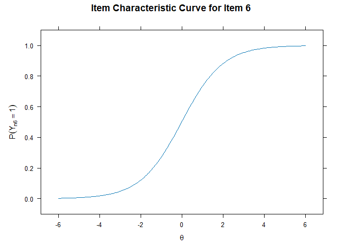{#fig-ICC6_Rasch}

In the Rasch model, the item difficulty always lies at the inflection point of the ICC.
For Item 6, the estimated difficulty is $\beta_6 = -0.018$.
At $\theta = -0.018$ in @fig-ICC6_Rasch, the probability of responding with 1 is exactly 50%.
This is also the point at which the curve changes its curvature, which defines an inflection point: to the left of it, the curve becomes steeper and steeper, and to the right of it, flatter and flatter.
The ICC is therefore steepest at the item difficulty, where the item distinguishes best between persons with slightly lower and slightly higher levels of environmental concern.

We can do the same for all items of the scale, which gives one ICC per item:

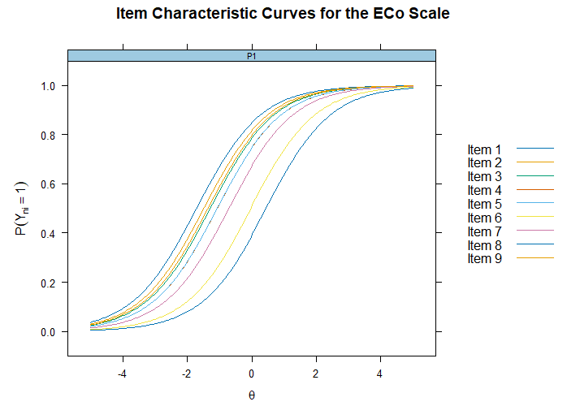{#fig-ICCEco_Rasch}

@fig-ICCEco_Rasch shows that the ICCs of different items are shifted along the x-axis according to their difficulties.
A more difficult item lies further to the right on the $\theta$ continuum, so the point at which its ICC reaches 50%, its inflection point, lies further to the right as well, and with it the entire curve.

In the Rasch model, all ICCs have the same shape and differ only in this shift, so they run in parallel and never cross.
As a result, at every value of $\theta$, a more difficult item is less likely to be answered with a 1 than an easier item: in the figure, the curves further to the right always lie below those further to the left.
The order of the items by difficulty is therefore the same for all persons, a property known as *invariant item ordering*.
It is the probabilistic counterpart of the cumulative reading of the construct map (@fig-construct-map): whatever a person's level of environmental concern, easier items are more likely to be agreed with than harder ones.

In the same way, persons with higher $\theta$ values are more likely to respond with 1 than persons with lower $\theta$ values, and this holds for every item.
In the figure, every ICC is higher at $\theta = 2$ than at $\theta = -2$.

::: {.callout-note appearance="simple"}
## Let's do it in R

To plot the ICC of a single item, we can use the `itemplot()` function from `mirt` with the following arguments:

```{r}
# plotting an ICC of a specific item

itemplot(eco_rasch,     # <1>
         item = 6,      # <2>
         type="trace")  # <3>
```

1.  `object`: Here, we pass in the IRT model that we estimated using the `mirt()` function (here: `eco_rasch)`.

2.  `item`: Here, we specify which item we want to plot.
    We can either enter a number or the item name.
    So instead of 6, we could also specify “Eco_cog_6_dicho”.

3.  `type` = Here we can specify what should be plotted.
    To obtain the ICC, select “trace”.

If we want to plot the ICCs for all items at the same time, we can use the `plot()` function:

```{r}
# plot all ICCs of a scale

plot(eco_rasch,          # <1>
     type="trace",       # <2>
     theta_lim=c(-5,5),  # <3>
     facet = FALSE)      # <4>
```

1.  `object`

2.  `type` = Here we can specify what should be plotted.
    To obtain the ICC, select “trace.”

3.  `theta_lim`: Here, we can specify the range of $\theta$ values shown in the plot.
    In other words, we can specify the interval of the x-axis that should be plotted.

4.  `facet`: If we set this argument to `FALSE`, all ICCs are plotted in a single frame.
    If we set the argument to `TRUE` or omit it, we get a grid of plots, with the ICC for each item plotted in its own cell.

Here's an example of what happens when you set `facet = TRUE`:

```{r}
plot(eco_rasch, type="trace", theta_lim=c(-5,5), facet = TRUE)
```
:::

#### Wright Map {#sec-wright-map}

The more items a scale has, the harder ICC plots become to read [@wilsonConstructingMeasuresItem2023].
A more compact visualization is the *Wright map*, also known as the *person-item map*.
It makes use of the fact that, in the Rasch model, the probability of responding with 1 depends only on the difference between $\theta$ and $\beta$, so that both parameters can be placed on the same scale [@wilsonConstructingMeasuresItem2023, p. 142].
We already used this idea when interpreting the model parameters (see @sec-mod_par), and @fig-one_continuum is in fact a simple Wright map.

Before we look at the Wright map for the ECo scale, we use a fictional example, based on the scenario from @fig-one_continuum, to show how to read it.
The vertical axis on the right, labeled “Logits,” represents the latent continuum on which both persons and items are located.
Its unit is the logit, because the model sets the difference between $\theta$ and $\beta$ equal to the log-odds of responding with 1 (see @eq-rasch-logit): a person whose level lies one logit above the difficulty of an item responds to it with 1 with a probability of about 73%.
The items are shown along the x-axis, and each point marks the difficulty $\beta_i$ of an item.
For example, reading off the y-value of the point for Item 3 shows that its difficulty is about −1.8.
On the left, labeled “Respondents,” a histogram shows the distribution of the person parameters $\theta_n$ along the same scale.
With large samples, such as the 500 simulated persons here, plotting every $\theta_n$ individually would be unreadable, so their distribution is shown instead.
In this example, it is approximately normal: most persons have values around 0, and very high or very low values are rare.
For illustration, three persons with different $\theta$ values are marked with colored dashed lines.

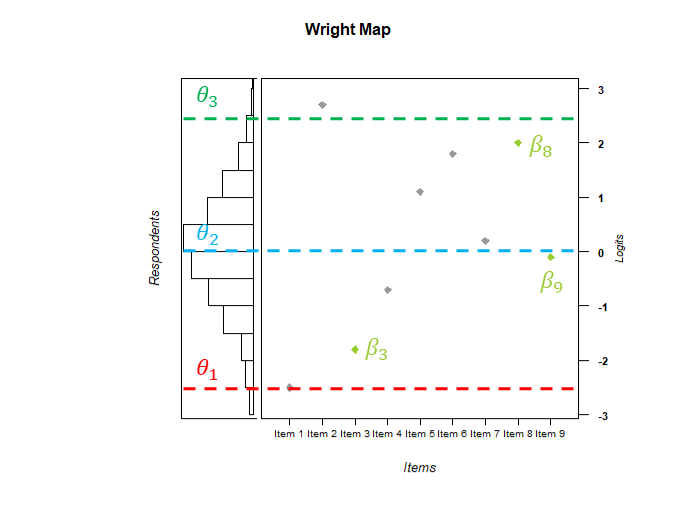{#fig-wright_map_example}

The core idea behind the Wright map is that it allows us to compare items and persons directly and thus assess how well our scale matches the sample we are measuring.
Take Person 1, who has a very low level on the latent variable ($\theta_1 = -2.5$); for the ECo scale, this would be a person with very little environmental concern.
Virtually all items except Item 1 lie considerably above Person 1's level, that is, above the red dashed line.
Recall that the item difficulty $\beta_i$ is the value of $\theta$ at which the probability of responding with 1 is 50%.
Even without looking at the ICCs, we can therefore see that Person 1's probability of responding with 1 is well below 50% for most items, so they will likely respond with 0 to most of them.
Put simply, the scale is too difficult for Person 1.

For Person 3, it is exactly the opposite.
This person's level is so high ($\theta_3 = 2.5$) that it lies above the difficulties of all items except Item 2.
Person 3's probability of responding with 1 is therefore greater than 50% for most items.
Put simply, the scale is too easy for Person 3.

Person 2 lies between the other two persons, with a moderate level ($\theta_2 = 0$).
Some items lie below the blue line, so Person 2's probability of responding to them with 1 is greater than 50% (e.g., Item 3); some lie above it, so this probability is less than 50% (e.g., Item 8); and some lie very close to it, so the probability is about 50% (e.g., Item 9).
This person will therefore likely agree with some items and disagree with others.
For another illustrative example and an intuitive introduction to the Wright map, see @wilsonConstructingMeasuresItem2023.

To measure a person's level accurately, it is best if the difficulties of the items ($\beta_i$) are close to that level ($\theta_n$); we will see why in @sec-Information.
It follows that the item difficulties should cover the entire range of the latent variable we want to measure [@debelakIntroductionRaschModel2022].
The Wright map makes this easy to check [e.g., @debelakIntroductionRaschModel2022, Figure 4.1; @chenMakingSenseGraphical2026].
In our example, the items are spread across the entire length of the histogram.
There are items located at the center of the $\theta$ distribution (e.g., Item 9) as well as items located at its edges (e.g., Items 3 and 8), so the scale covers the levels of the latent variable that occur in the sample.

The Wright map also allows us to link the estimated parameters to the construct map [@wilsonConstructingMeasuresItem2023].
In @sec-construct-map, we formulated the construct map as a hypothesis about which responses should be easy and which hard to give.
Because the waypoints describe positions on the same continuum as $\theta$ and $\beta$, we can place them on the Wright map and check whether each item is located near the waypoint it was meant to indicate [@wilsonConstructingMeasuresItem2023, p. 148].
If theory and data agree, this indicates that the instrument works as intended, although it does not replace a full validation.
Discrepancies are informative as well [@wilsonConstructingMeasuresItem2023].
If, for example, an item intended to indicate a low waypoint turns out to be located near a mid-level waypoint, either the item does not work as intended and has to be revised, or the construct map is wrong and its waypoints need to be reconsidered.
In this way, the Wright map helps to identify such problems early in the development of an instrument.
For further discussion and examples, see @wilsonConstructingMeasuresItem2023.

::: {.callout-note appearance="simple"}
## Let's do it in R

To create a Wright map in R, we are using the `WrightMap` package [@torresirribarraWrightMapIRTItemperson2014].

Before we can create the map itself we have to prepare the data.

```{r}
# load package

library(WrightMap)                                                          # <1>

# prepare data for wright map

theta <- fscores(eco_rasch, method = "EAP")[,1]                             # <2>
beta <- coef(eco_rasch, IRTpars = TRUE, simplify = TRUE)$items[, "b"]       # <3>

```

1.  First, we load the package so that we can use it in our R session.
    If you have not installed it yet, you can do so with `install.packages("WrightMap")`.

2.  Next, we store the estimated person parameters ($\theta_n$) in an object called `theta`.
    The code should be familiar from earlier, so we will not explain it in detail here.
    The only new element is `[, 1]` at the end.
    `fscores()` returns a matrix with one column per latent variable, and since our model has only one, `[, 1]` selects this column (all rows, first column), which gives us a simple vector of $\theta_n$ values.

3.  Here, we store the item difficulties ($\beta_i$) in an object called `beta`.
    This code should be familiar as well.
    As we saw above, the output of `coef()` has three sections.
    We only need the item parameters, so we extract them by adding `$items` to the code.
    Of these, the Rasch model only requires the item difficulties, which we select with `[, "b"]` (all rows, only the `b` column).
    This column exists because we set `IRTpars = TRUE`, as before.

Now we can create the plot with the `wrightMap()` function.

```{r}
#| results: hide
# plotting the Wright map

wm <- wrightMap(theta,                                    # <1>
                beta,                                     # <2>
                label.items = paste("Item", 1:9),         # <3>
                show.thr.lab = FALSE,                     # <4>
                item.side   = itemModern,                 # <5>
                main.title  = "Wright Map")               # <6>
```

1.  Here, we pass the person locations, $\theta_n$.

2.  Here, we pass the item locations, that is, the item difficulties $\beta_i$.

3.  Here, we define the item names shown in the plot.
    Since the variable names in the ECo data are quite long, we simply number the items to keep the plot clear.
    To use the variable names from the data instead, replace `paste()` with `names(beta)`.

4.  This argument controls whether the thresholds of each item are labeled.
    In models for items with more than two response categories, each item has several thresholds, which then need labels to tell them apart.
    In the Rasch model, each item has only one, its difficulty, so we turn the labels off.

5.  Here, we specify how the item side of the map is drawn.
    `itemModern` shows each item as a point at its difficulty, with the items arranged along the x-axis.
    Alternatives include `itemClassic`, which lists the items as text next to the scale, and `itemHist`, which shows the distribution of the item difficulties as a histogram.
    For all options, see the function's documentation (`?wrightMap`).

6.  Here, we give the plot a title.


Let us now compare the Wright map for the ECo scale with the construct map from @sec-construct-map.
The construct map led us to expect three groups of items: Items 1, 2, 4, and 5 at waypoint 2 (aware and worried), Items 3 and 6 at waypoint 3 (priority for the environment), and Items 7, 8, and 9 at waypoint 4 (willingness to bear personal costs).

The estimated item difficulties confirm this order only partly.
As expected, Items 1 and 2 are the easiest items, Items 4 and 5 are also located at the lower end, and Item 8, on paying much higher taxes, is the hardest.
The two upper waypoints, however, are not separated as expected: Item 6 is harder than two of the three items of waypoint 4, while Item 3 is located among the items of waypoint 2.
Most strikingly, Item 9, on accepting cuts in the standard of living, is one of the easiest items, although we placed it at the highest waypoint.
Waypoint 2 is thus well supported, whereas the distinction between waypoints 3 and 4 is not supported in the form we formulated it.
As discussed in @sec-construct-map, such discrepancies indicate that either the items or the construct map need to be reconsidered.

The person side shows where the respondents are located relative to the items.
Most respondents lie between about 0 and 2 logits, above most items, so they are likely to agree with nearly all of them.
For a large share of the sample, even the hardest item lies below their level, so the scale cannot distinguish among these respondents.
Doing so would require items located higher on the continuum: either better items for the highest waypoint, which Item 9 in particular fails to reach, or items for an additional waypoint above it.

We have to keep in mind, however, that this Wright map refers to the dichotomized items.
By combining the two highest response categories into a single category of agreement, we discarded the distinction between agreeing with an item and fully agreeing with it, which is exactly what separates high from very high concern.
The pattern visible here is therefore largely a consequence of our dichotomization and should not be read as an evaluation of the ECo scale itself.
:::

### Assumptions and Properties of the Rasch Model

#### Unidimensionality

So far, we have assumed that the probability of responding to an item with 1 depends on only one person parameter.
The formula shows this as well: $\theta_n$ is the only parameter with the person index $n$.
In other words, the model assumes that a single latent variable accounts for the differences between persons in their responses to all items.
This is called the *unidimensionality assumption*.

::: {.callout-important appearance="simple"}
## Be Careful

Note that the latent variable $\theta$ is not the same as the construct we want to measure.
$\theta$ is a quantity in a statistical model.
That it captures environmental concern is an assumption we make based on the construct definition, the construct map, and the content of the items, and it has to be supported by evidence of validity.

The same caution applies to unidimensionality.
When a model with a single $\theta$ fits well, we learn that one latent variable is enough to describe how these persons responded to these items [@vandermaasCognitivePsychologyMeets2011, p. 353].
This does not imply that the construct has only one facet.
Environmental concern is defined by cognitive, affective, and conative components, and yet the responses to the ECo items can be described by a single latent variable [@gommHowMeasureEnvironmental2026].
The number of dimensions is thus a property of the responses, and what it means for the construct has to be judged against the construct definition.
:::

#### Local Independence

A further assumption, closely tied to unidimensionality, is *local independence*, sometimes called *conditional independence* [@bollen_latent_2002].
It states that a person's responses to the items are independent of one another once we condition on $\theta_n$.
In other words, $\theta_n$ is the only thing the responses to different items have in common.
The link to unidimensionality is direct: if a single latent variable accounts for the responses, nothing else is left to connect them.
Take the ECo scale.
Across the whole sample, the responses to the items are correlated, because persons with a high $\theta_n$ tend to agree with most items and persons with a low $\theta_n$ tend to disagree with most of them.
Local independence says that this is the whole reason for the correlation.
Among persons with the same $\theta_n$, the correlation disappears: knowing how such a person answered one item tells us nothing about how they answered another.

::: {.callout-tip appearance="simple"}
## Mathematical Background

Local independence can be written as follows [@lordApplicationsItemResponse1980, p. 19]:

$$\begin{align}
P(Y_{ni} = 1 \mid \theta_n) = P(Y_{ni} = 1 \mid \theta_n, Y_{nj}, Y_{nk}, \dots) \quad (i \neq j, k, \dots)
\end{align}$$ {#eq-local_indi_1}

On the left is the probability that person $n$ answers item $i$ with a 1, given $\theta_n$.
On the right is the same probability, given $\theta_n$ and the person's answers to all other items.
The two are equal: once we know $\theta_n$, the answers to the other items tell us nothing more about the answer to item $i$.

An equivalent way to write this is [@lordApplicationsItemResponse1980, p. 19]:

$$\begin{align}
&P(Y_{ni} = 1, Y_{nj} = 1, Y_{nk} = 1 \mid \theta_n) \\
&= P(Y_{ni} = 1 \mid \theta_n) \cdot P(Y_{nj} = 1 \mid \theta_n) \cdot P(Y_{nk} = 1 \mid \theta_n)
\end{align}$$ {#eq-local_indi_2}

The probability that person $n$ answers all three items $i$, $j$, and $k$ with a 1, given $\theta_n$, is the product of the three separate probabilities.
The same holds for any other combination of answers and for any number of items.
:::

If local independence is violated, something other than $\theta_n$ connects a person's responses.
One possibility is a second latent variable.
Political ideology, for example, might affect the responses to some ECo items over and above environmental concern [e.g., @cruzRelationshipsPoliticalIdeology2017].
Our model has a single $\theta$ and cannot represent this.^[Multidimensional IRT models can, but they are beyond the scope of this tutorial.]
Another possibility has nothing to do with a further "substantive" trait.
With item order effects, for example, the answer to one item shapes the answer to the next.
The two cases are conceptually different.
Local independence is therefore not the same assumption as unidimensionality [@deayalaTheoryPracticeItem2022, p. 22].
In the data, however, the two cases look alike: if responses remain associated after conditioning on $\theta_n$, we can describe this as local dependence between items or as an additional latent variable, and the data generally cannot tell us which description applies [@ip2010].
For an overview of sources of local dependence, see @yenScalingPerformanceAssessments1993.

We can check local independence with Yen's $Q_3$ [@yenEffectsLocalItem1984].
For every person and every item, we compute a residual: the difference between the observed response and the response the Rasch model expects given the person's estimated $\theta_n$.
If local independence holds, the model has already accounted for everything the items have in common, so the residuals of two different items should be essentially uncorrelated.
A correlation between the residuals of two items suggests that they share something the model has not captured.
$Q_3$ is exactly this correlation, computed for every pair of items.

::: {.callout-tip appearance="simple"}
## Mathematical Background

$Q_3$ is computed in two steps [@yenEffectsLocalItem1984; see also @christensenCriticalValuesYens2017].

First, we compute the residual for the response of person $n$ to item $i$:

$$d_{ni} = Y_{ni} - \hat{P}(Y_{ni} = 1 \mid \hat{\theta}_n)$$

$Y_{ni}$ is the response that person $n$ gave to item $i$ (0 or 1).
$\hat{P}(Y_{ni} = 1 \mid \hat{\theta}_n)$ is the probability of a 1 that the Rasch model predicts for this person on this item.
The hats indicate that the probability and $\theta_n$ are estimated from the data.
The residual is thus the difference between what the person answered and what the model expected.
We compute it for every person on every item.

Second, we correlate the residuals of two items across all persons:

$$Q_{3,ij} = r_{d_i,d_j}$$

Here $d_i$ stands for the residuals of all persons on item $i$, and $d_j$ for the residuals of all persons on item $j$.
:::

If local independence holds, we expect the $Q_3$ values of all item pairs to be close to zero.
The larger the $Q_3$ value of a pair, the more the two items have in common that the Rasch model does not explain.
This leaves the question of how large $Q_3$ must be before we conclude that local independence is violated.
A value often used in the literature is .20 [@nasonAnotherLookYens2025]: item pairs with $Q_3$ above .20 are treated as locally dependent.

This cut-off, however, is only a rule of thumb.
A $Q_3$ value above .20 does not guarantee that local independence is violated, and values below .20 do not guarantee that it holds [e.g., @nasonAnotherLookYens2025].
$Q_3$ values are also slightly negative on average even when local independence holds, so a value should be judged by how far it lies above the average $Q_3$, not by its distance from zero [@yenEffectsLocalItem1984; @christensenCriticalValuesYens2017].

Beyond that, two questions have to be kept apart.
The first is whether a value is larger than chance alone would produce.
No fixed cut-off can answer this, because how large $Q_3$ gets by chance depends on the number of items, the sample size, and the number of response categories.
A parametric bootstrap can: we simulate many data sets from the fitted Rasch model, in which local independence holds by construction, and see how large $Q_3$ gets there.^[A parametric bootstrap treats the fitted model as if it were true. We use the estimated item parameters and the estimated distribution of $\theta$ to generate new responses for as many persons as there are in our data. In these simulated data sets, $\theta$ is the only thing the items have in common, so local independence holds. We then analyse every simulated data set exactly like the real one: we fit the Rasch model and compute $Q_3$ for all item pairs. Repeating this many times shows which $Q_3$ values occur when the model is true, and we can compare the values from our data with them. The bootstrap is called parametric because the new data are generated from the parameters of the model and not by resampling persons from the observed data.]
The second question is how strong the dependence is, and this is what the size of the value tells us.
The two answers can differ: with many respondents, a small dependence can be clearly more than chance, and with few respondents, a large value can still be chance.
We show how to answer both questions in the R section below.

::: {.callout-note appearance="simple"}
## Let's do it in R

We can check local independence for our model with Yen's $Q_3$ [@yenEffectsLocalItem1984].

```{r}
#| output: false


eco_rasch_Q3 <- mirt::residuals(eco_rasch, type = "Q3")
```

To make the output easier to read, we rename the rows and columns of the resulting matrix.

```{r}

row.names(eco_rasch_Q3) <- c(paste("Item", 1:9))
colnames(eco_rasch_Q3) <- c(paste("Item", 1:9))

eco_rasch_Q3

```

The matrix contains every item pair twice, once above and once below the diagonal.
The diagonal itself holds the correlation of each item with itself, which is always 1.
`upper.tri()` selects the cells above the diagonal, so each pair is counted once and the diagonal is left out.
We can then check whether any item pair exceeds the cut-off of .20:

```{r}
# each item pair once: the cells above the diagonal
eco_Q3_pairs <- eco_rasch_Q3[upper.tri(eco_rasch_Q3)]

# does any item pair exceed .20?
any(eco_Q3_pairs > 0.2)  # TRUE if at least one item pair exceeds .20
```

If at least one item pair exceeds .20, we can find out which pairs these are.

```{r}
# which item pairs are affected?
which(eco_rasch_Q3 > 0.2 & upper.tri(eco_rasch_Q3), arr.ind = TRUE)
```

With `arr.ind = TRUE`, `which()` returns the row and the column of each flagged value.
Here the output is empty, because no item pair exceeds the cut-off.

We can also judge the values relative to the average $Q_3$ (see the box above), flagging item pairs that lie more than .20 above it.

```{r}
# average Q3 across all item pairs
mean(eco_Q3_pairs)

# which item pairs lie more than .20 above the average?
which(eco_rasch_Q3 - mean(eco_Q3_pairs) > 0.2 & upper.tri(eco_rasch_Q3), arr.ind = TRUE)
```

The average $Q_3$ is −.10, and two item pairs lie more than .20 above it, Items 1 and 2 and Items 7 and 8, although no pair exceeded the fixed .20.

##### Bootstrap
Both checks so far concern the size of the $Q_3$ values.
To find out which values are larger than chance alone would produce, we use a parametric bootstrap, as explained above.
We simulate 1,000 data sets from our fitted Rasch model, fit the Rasch model to each of them, and store the largest and the average $Q_3$ value.

```{r}
#| cache: true
#| warning: false

future::plan(future::multisession, workers = 8)   # use 8 cores

set.seed(666)    # makes the simulation reproducible
n_boot <- 1000   # number of simulated data sets

boot_Q3 <- future.apply::future_replicate(n_boot, {
  # simulate a data set from the fitted Rasch model (local independence holds)
  sim_data  <- mirt::simdata(model = eco_rasch)
  # fit the Rasch model to the simulated data and compute Q3
  sim_rasch <- mirt::mirt(sim_data, model = 1, itemtype = "Rasch", verbose = FALSE)
  sim_Q3    <- mirt::residuals(sim_rasch, type = "Q3", verbose = FALSE)
  # keep each item pair once, then return the largest and the average value
  sim_Q3    <- sim_Q3[upper.tri(sim_Q3)]
  c(max = max(sim_Q3), mean = mean(sim_Q3))
})

future::plan(future::sequential)     # switch parallel computing off again

boot_max  <- boot_Q3["max", ]
boot_mean <- boot_Q3["mean", ]
```

Each simulated data set gives us one value: how far its largest $Q_3$ lies above its average $Q_3$.
Since local independence holds in the simulated data sets, these 1,000 values show how large this difference gets by chance alone.
We use their 95th percentile as the cut-off, that is, the value that 95% of the simulated data sets stay below.
We then compute the same difference in our data.

```{r}
# cut-off: 95th percentile of (largest Q3 - average Q3) across the simulated data sets
cutoff <- quantile(boot_max - boot_mean, probs = 0.95)
cutoff

# the same difference in our data
eco_Q3_pairs <- eco_rasch_Q3[upper.tri(eco_rasch_Q3)]
max(eco_Q3_pairs) - mean(eco_Q3_pairs)
```

The cut-off is .04: in 95% of the simulated data sets, the largest value lies no more than .04 above the average.
In our data, it lies .27 above the average.
We can see which pairs lie above this cut-off:

```{r}
# which item pairs lie above the bootstrap cut-off?
which(eco_rasch_Q3 - mean(eco_Q3_pairs) > cutoff & upper.tri(eco_rasch_Q3), arr.ind = TRUE)
```

Seven of the 36 item pairs lie above the bootstrap cut-off.
The three criteria thus give three different answers: the fixed .20 flags no pair, .20 above the average flags two, and the bootstrap flags seven.
With many respondents, even small dependencies exceed what chance alone would produce.
The size of the dependence is a separate question: only two of the seven pairs, Items 1 and 2 and Items 7 and 8, lie more than .20 above the average.

The flagged pairs are not scattered across the scale. Items 7, 8, and 9 are all more strongly related to one another than the Rasch model predicts, and so are Items 1, 2, and 5. The remaining pair, Items 3 and 5, consists of the two negatively worded items. Such groups suggest that these items share something beyond $\theta$. As discussed above, the data cannot tell us whether to call this local dependence or an additional latent variable; to decide what the groups mean, we have to look at the content of the items.

:::

#### Sufficient Statistic

A distinctive feature of the Rasch model is that the total score—that is, the number of items a person answered with a 1—is a sufficient statistic for $\theta$.
This means that if you know a person's total score, you know everything the data contain about $\theta$; in other words, the data does not provide any further information about $\theta$ beyond the total score [@lordApplicationsItemResponse1980, p.57].
In the [Appendix](#sec-appendix1) you can find a mathematically grounded explanation of this point.

So, if you want to estimate a person’s $\theta$, it is sufficient to know how many items a person answered with a 1 (= total score), and it is irrelevant which specific items a person answered with a 1.
This means that people who answered the same number of items with a 1 are estimated to have the same $\theta$.
This can lead to the paradoxical effect that a person who, for example, answered three easy items with a 1 but failed to answer the more difficult items with a 1 is assigned the same $\theta$ as a person who failed at answering the easy items with a 1 but answered three difficult items with a 1.

The same applies to item difficulty.
The number of people who answered an item with a 1 is a sufficient statistic for item difficulty.
Therefore, it is enough to know how many people answered an item with a 1, rather than which specific people answered it with a 1.

::: {.callout-important appearance="simple"}
## Be Careful

The property of a sufficient statistic holds only as long as the assumptions of the Rasch model hold.
For other IRT models, the total score is not a sufficient statistic.
:::

#### Specific Objectivity

The property of specific objectivity means that, when comparing individuals in terms of their $\theta$ values, it does not matter which item is used.
This means that a person who, for example, has higher levels of environmental concern will always be more likely to agree with an item that measures environmental concern than a person with lower levels of environmental concern, regardless of which item on the ECo scale is used as the basis for comparison.

Conversely, the comparison of items is independent of which individuals answered the item.
For example, a more difficult item always requires higher levels of environmental concerns than an easier item; or, to put it another way, a more difficult item is more difficult for all individuals than an easier item, regardless of the individual’s $\theta$ level.

That should sound familiar to us, because we've already seen this very characteristic in the ICCs.
We have already noted that, in the Rasch model, the ICCs all run parallel to one another and are shifted along the x-axis only according to their item difficulty (see @fig-ICCEco_Rasch).
This parallelism satisfies the requirement for specific objectivity.
Thus, we can see that the higher a person’s $\theta$ is, the higher the probability of answering the item with a 1 ($P(Y_{ni} = 1)$), regardless of which item we are considering.
This is also evident in @fig-ICC_spec_obj_Rasch : Regardless of whether it is Item 1 or Item 2, the green person ($\theta = 2$) always has a higher probability of answering ($P(Y_{ni} = 1)$) (see the point of intersection with the y-axis) than the pink person ($\theta = -2$).

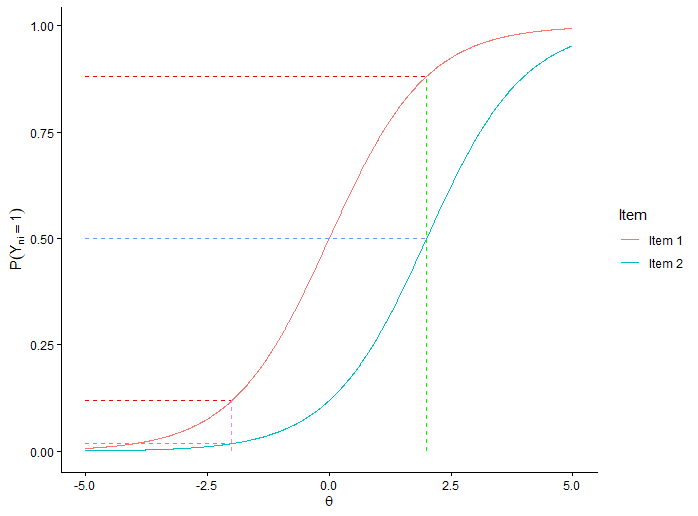{#fig-ICC_spec_obj_Rasch}

Conversely, we see that regardless of whether we consider the green person ($\theta = 2$) or the pink person ($\theta = -2$), both individuals have lower response probabilities on the more difficult Item 2 than on Item 1.
This is evident from the fact that the red horizontal dashed line for Item 1 for each person always lies above the blue horizontal dashed line for Item 2.

::: {.callout-important appearance="simple"}
## Be Careful

The property of specific objectivity holds only as long as the assumptions of the Rasch model hold.
Specific objectivity does not apply to other IRT models.
:::

However, as soon as the ICCs are no longer parallel, specific objectivity no longer applies, since it may then be the case, for example, that a person with a lower $\theta$ has a higher probability of answering an item with a 1 than a person with a higher $\theta$, while the opposite is true for another item as can be seen in @fig-ICC_spec_obj_2PL .
Here, the pink person ($\theta = -2$) is more likely to answer Item 2 with a 1 than Item 1.
For the blue person ($\theta = 2$), it is exactly the opposite.
So, here, for example, the probability of answering an item with a 1 is not always lower for a more difficult item (Item 2), as the pink person demonstrates.

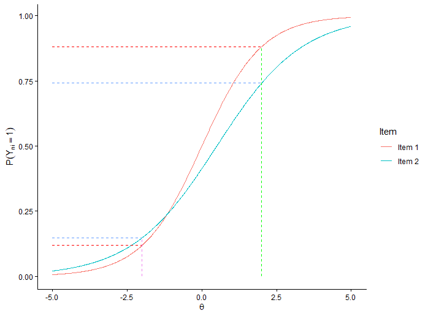{#fig-ICC_spec_obj_2PL}

::: {.callout-tip appearance="simple"}
## Mathematical Background

It can also be shown mathematically that specific objectivity holds under the Rasch model, as demonstrated, for example, in @debelakIntroductionRaschModel2022 [p. 30] and below.

To illustrate this, let's imagine we want to compare two people, $n$ and $n^\prime$.
To do this, we can look at the difference in the probability that each person answers 1 to the item.
To calculate the probability that a person will answer the item with a 1, we can use the formula from the Rasch model:

$$P(Y_{ni} = 1) - P(Y_{n^\prime i} = 1) = \frac{\exp(\theta_n - \beta_i)}{1 + \exp(\theta_n - \beta_i)} - \frac{\exp(\theta_{n^\prime} - \beta_i)}{1 + \exp(\theta_{n^\prime} - \beta_i)}$$

However, if instead of calculating the probability that a person will answer the item with 1, we now want to calculate the log odds, then we can rewrite the formula for the Rasch model.
We have learned that we can also think of the Rasch model as a generalized linear model.
Therefore, if we apply the inverse of our link function to our dependent variable (the probability of answering an item with a 1), we obtain only the linear term ($\theta_n - \beta_i$) on the predictor side of the equation, and the dependent variable is transformed into the log odds:

$$\ln\left(\frac{P(Y_{ni} = 1)}{1 - P(Y_{ni} = 1)}\right) = \theta_n - \beta_i$$

If we now rewrite the comparison of the persons accordingly, we get:

$$\begin{aligned}
\ln\left(\frac{P(Y_{ni} = 1)}{1 - P(Y_{ni} = 1)}\right) - \ln\left(\frac{P(Y_{n^\prime i} = 1)}{1 - P(Y_{n^\prime i} = 1)}\right) &= (\theta_n - \beta_i) - (\theta_{n^\prime} - \beta_i)\\
&= \theta_n - \beta_i - \theta_{n^\prime} +  \beta_i\\
&= \theta_n - \theta_{n^\prime} +  \beta_i - \beta_i\\
&= \theta_n - \theta_{n^\prime}
\end{aligned}$$

As you can see, in the end, only the comparison of $\theta$ remains, and the item parameters cancel out.
This means that when comparing two individuals, $n$ and $n^\prime$, it does not matter on which items the two individuals are compared.
This corresponds to the definition of specific objectivity.

The same can be shown for the comparison of two items, $i$ and $i^\prime$:

$$\begin{aligned}
\ln\left(\frac{P(Y_{ni} = 1)}{1 - P(Y_{ni} = 1)}\right) - \ln\left(\frac{P(Y_{ni^\prime} = 1)}{1 - P(Y_{ni^\prime} = 1)}\right) &= (\theta_n - \beta_i) - (\theta_{n} - \beta_{i^\prime})\\
&= \theta_n - \beta_i - \theta_n +  \beta_{i^\prime}\\
&= \theta_n - \theta_n + \beta_{i^\prime} - \beta_i\\
&= \beta_{i^\prime} - \beta_i
\end{aligned}$$

Here, too, we see that when comparing items, the person-specific parameters cancel each other out.
Therefore, when comparing two items, $i$ and $i^\prime$, it does not matter which individuals answered the two items.
This, too, is consistent with the definition of specific objectivity.
:::

Ultimately, specific objectivity is related to a form of fairness, since it requires that a comparison is based solely on the latent construct ($\theta$) and does not depend on the items used to measure the construct [@debelakIntroductionRaschModel2022, p. 28].
With regard to test development, it is also important that the comparison of different items not depend on who answers them.
This, too, ensures a specific level of objectivity [see @raschGeneralLawsMeaning1961, p. 332; @wilsonConstructingMeasuresItem2023, p. 248].

### Identifiability {#sec-identi-Rasch}

Although the exact estimation procedures for fitting a Rasch model to the data are not covered in detail in this tutorial, it is important to note at this point that the Rasch model has an identifiability problem.
This is due to the fact that the scale on which we locate $\theta$ and $\beta$ is a latent scale.
Since latent constructs are abstract and cannot be directly observed, they do not have a natural origin and metric [see also @debelakIntroductionRaschModel2022, for an illustration of this point] .

This has consequences for the estimation of our model parameters.
This is because the choice of the origin of a latent scale is arbitrary as long as we use the same origin for the $\theta$ scale and $\beta$ scale [@lordApplicationsItemResponse1980].
This is because, as we already saw, only the discrepancy between $\theta_n$ and $\beta_i$ is relevant for the probability that a person will respond to an item with a 1.
This means that as long as we keep the relative distance between the person and the item constant, we can shift the $\theta$ and $\beta$ parameters arbitrarily along the continuum without changing the probability that a person will answer an item with a 1.
To make it more concrete and intuitive: In theory, there are an infinite number of $\theta$ and $\beta$ combinations that can produce the same response probability $P(Y_{ni} =1\mid \theta_n, \beta_i)$.
For example, the probability that a person will answer an item with a 1 is the same for a person with $\theta = 4$ and $\beta = 2$ ($\theta - \beta = 4 - 2 = 2$) as for a person with $\theta = 6$ and $\beta = 4$ ($\theta - \beta = 6 - 4 = 2$) or for any other $\theta$ and $\beta$ combination that produces a difference of 2.
If the Rasch model now attempts to estimate $\theta$ and $\beta$ based on the data, the model cannot find a unique solution, since there are theoretically an infinite number of combinations that are equally likely for the data.
This is also referred to as the identifiability problem; in other words, the model is said to be unidentifiable [see also @deayalaTheoryPracticeItem2022, p. 44].

::: {.callout-tip appearance="simple"}
## Mathematical Background

**Additive Indeterminacy** [@debelakIntroductionRaschModel2022; @lordApplicationsItemResponse1980]

Let's say we add a constant $c$ to our $\theta_n$ and $\beta_i$ so we get the new parameters $\theta_n'$ and $\beta_i'$.

$$\begin{aligned}
\theta_n' &= \theta_n + c\\
\beta_i' &= \beta_i + c
\end{aligned}$$

So now we can calculate the probability that a person will choose a 1 to respond to the item based on these two parameter sets.
Note that for a clearer notation we don't calculate the probability but the log odds, so that we have just a linear term on the right-hand side of the equation:

$$\begin{aligned}
\ln\left(\frac{P(Y_{ni} = 1\mid\theta_n, \beta_i)}{P(Y_{ni} = 0\mid\theta_n, \beta_i)}\right) &= \theta_n - \beta_i\\
\ln\left(\frac{P(Y_{ni} = 1\mid\theta_n', \beta_i')}{P(Y_{ni} = 0\mid\theta_n', \beta_i')}\right) &= \theta_n' - \beta_i'
\end{aligned}$$

We have already said that the model is unidentifiable if we apply an additive constant to both $\theta_n$ and $\beta_i$.
If this is true, then we should get the same log-odds for both sets of parameters.
If we write out the formula and rearrange it a bit, we can see this very clearly.
The additive constants cancel each other out, so that in the end we are left with $\theta_n - \beta_i$ again.
The model is therefore unidentifiable.

$$\begin{aligned}
\ln\left(\frac{P(Y_{ni} = 1\mid\theta_n, \beta_i)}{P(Y_{ni} = 0\mid\theta_n, \beta_i)}\right) &= \ln\left(\frac{P(Y_{ni} = 1\mid\theta_n', \beta_i')}{P(Y_{ni} = 0\mid\theta_n', \beta_i')}\right)\\
\theta_n - \beta_i &= \theta_n' - \beta_i'\\
&= (\theta_n + c) - (\beta_i + c)\\
&= \theta_n + c - \beta_i - c\\
&= \theta_n - \beta_i + c - c\\&= \theta_n - \beta_i
\end{aligned}$$
:::

To solve this problem, we must ensure that our latent continuum has a unique origin and metric.
The unit of measurement in the Rasch model is already set to 1, since the $\alpha$ parameter is fixed at 1 in the Rasch model ([crossreference here to 1PL section]{.mark}), so we only need to specify the origin of the metric [@deayalaTheoryPracticeItem2022, p. 44].
There are various ways to do this [@deayalaTheoryPracticeItem2022; @lordApplicationsItemResponse1980] , known as restrictions (since the possible solutions for the model are restricted in order to ensure a unique solution).

- **sum norm restriction (item centering):** The idea here is that we give the model an additional “rule”: it should estimate the item difficulties $\beta$ such that the sum of the item difficulties equals 0 ($\sum_{i = 1}^I \beta_i = 0$).
  Simply put: Because the model now not only seeks the parameters most likely to predict the data but must also satisfy the new rule, there are no longer an infinite number of possible solutions, and the model becomes identifiable.

- **fix the difficulty of one item (anchor item):** The idea here is that we set the item difficulty $\beta_i$ of a given item to a specific value (usually $\beta_i = 0$).
  The logic here is that the items differ in their $\beta$ relative to one another.
  By fixing a $\beta_i$ (also known as “setting it”) and requiring the remaining items to maintain a certain distance from that item in order to reflect the relative distances, we obtain unique solutions.
  To put it simply, you can think of it this way: We know that Item 2 is two units more difficult than Item 1, and Item 3 is one unit easier than Item 1.
  Without any restrictions, there would now be an infinite number of possible $\beta$ values for these items, e.g., $\beta_1 = 2$, $\beta_2 = 4$, and $\beta_3 = 1$, or $\beta_1 = 10$, $\beta_2 = 12$, and $\beta_3 = 9$.
  However, if we now introduce a restriction and define that $\beta_1 = 0$ (fixing it), then there is only one solution for the other $\beta$ values that correctly represents the relative distances between the items, namely $\beta_2 = 2$ and $\beta_3 = -1$.

- **set expected value of person trait to 0 (person centering):** This is a similar idea to the sum norm restriction.
  We tell the model to estimate the $\theta$ values so that they predict the data as well as possible, but also so that the mean of the estimated $\theta$ values is 0.

Since the person parameters ($\theta$) and item parameters ($\beta$) lie on the same latent scale, it is sufficient to apply one of the restrictions mentioned to specify the origin of the metric [@deayalaTheoryPracticeItem2022, p. 44].

### Information {#sec-Information}

#### Item Information

A key concept in IRT that is very helpful for test development—and one that does not exist in this form in CTT—is item information.
One can think of information as a measure of measurement accuracy or precision.
One can understand this quite intuitively if one takes a closer look at the ICC of an item.

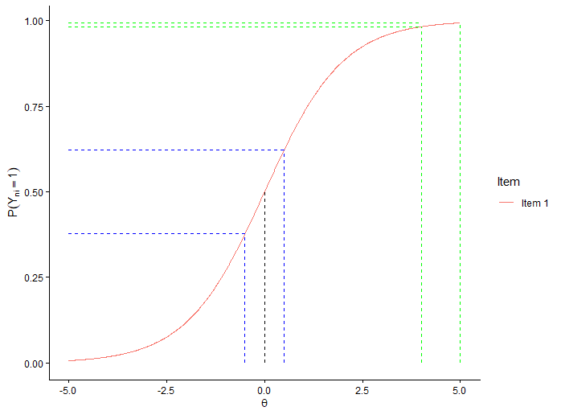{#fig-example_ICC_info}

The ICC plots the different $\theta$ values on the x-axis and the probability to respond to the item with a 1 on the y-axis.
We can see that the function follows an S-shaped curve.
Therefore, the slope of the function is not constant—as it is, for example, in a linear function—but varies depending on the point on the x-axis.
Consequently, we can see that the change in the probability to respond to the item with a 1 (y-axis) is different depending on the $\theta$-area on the continuum.

For example, for persons with very high $\theta$-values (or very low) the probability doesn't really change if the $\theta$ increases or decreases.
We can see this in @fig-example_ICC_info.
The two green persons have rather high $\theta$ values ($\theta_{\text{green1}} = 4$ and $\theta_{\text{green2}} = 5$).
Although person green2 has a $\theta$ value that is one unit larger, we can see on the y-axis that the probability that the individuals will answer 1 to the item barely differs from that of the person with the one unit smaller $\theta$ ($P(Y_{\text{green1}i} =1) = 0.98$ and $P(Y_{\text{green2}i} = 1) = 0.99$).
This is because, in the low and high $\theta$ ranges, the slope of the item function/ICC is quite flat.
This means that changes along the x-axis are hardly reflected in changes along the y-axis.

The situation is different when we consider the $\theta$ range around the item difficulty (here, $\beta_i = 0$).
Here, we see that the slope of the ICC is quite steep compared to the extremes.
Let's take a look at the two blue persons ($\theta_{\text{blue1}} = -0.5$ and $\theta_{\text{blue2}} = 0.5$) in @fig-example_ICC_info .
These two people differ by exactly one $\theta$ unit, just like the two green people.
However, we see here that this $\theta$ difference between the blue people makes a big difference in the probability that the person will answer the item with a 1.
Person “blue1” has a 38% probability of answering the item with a 1, while person “blue2” has a 62% probability.
Put simply, one could say that person "blue1" is unlikely to agree with the item, while person “blue2” is likely to agree with it.

So we see that the steeper the slope, the more differences in $\theta$ also make a difference in the response probability.
That’s why we can also say that the steeper the slope, the better we can distinguish or differentiate between individuals, even if they have very similar $\theta$ values.
We therefore “learn” the most about the $\theta$ values of individuals in those ranges of the $\theta$ continuum (x-axis) where the slope of the ICC is steep.
In other words, these ranges contain the most *information*.
Therefore item information shows us which areas of the $\theta$ continuum an item can capture especially well (in the sense of where it can differentiate between persons with $\theta$ values close to each other).

With this intuitive and visual introduction to the concept of information, it should now be clear that item information is related to the slope of the ICC.
The ICC reaches its steepest slope at the inflection point; accordingly, most of an item’s information is concentrated around the item difficulty, since we have learned that the item difficulty ($\beta$) marks the inflection point of the ICC.

::: {.callout-tip appearance="simple"}
## Mathematical Background

Mathematically, the item information for a certain $\theta_n$ value $I_i(\theta_n)$ for the Rasch model can be calculated by the probability of solving the item $p(Y_i = 1)$ times the probability of not solving the item $p(Y_i = 0)$ [@debelakIntroductionRaschModel2022, p. 51; @fischerRaschModelsFoundations1995, p.55]:

$$\begin{align}
I_i(\theta_n) &= p(Y_i = 1\mid\theta_n,\beta_i) \cdot p(Y_i = 0 \mid \theta_n,\beta_i)\\
&= \frac{\exp(\theta - \beta_i)}{1 + \exp(\theta - \beta_i)} \cdot \frac{1}{1 + \exp(\theta - \beta_i)}
\end{align}$$ {#eq-iteminfo}
:::

If we theoretically calculate for every possible $\theta_n$ value the Information $I_i(\theta_n)$ (see @eq-iteminfo) and plotting the $\theta$s on the x-axis and the item information on the y-axis, then we get the *Item-Information curve* (see @fig-example_item_info for an example) .

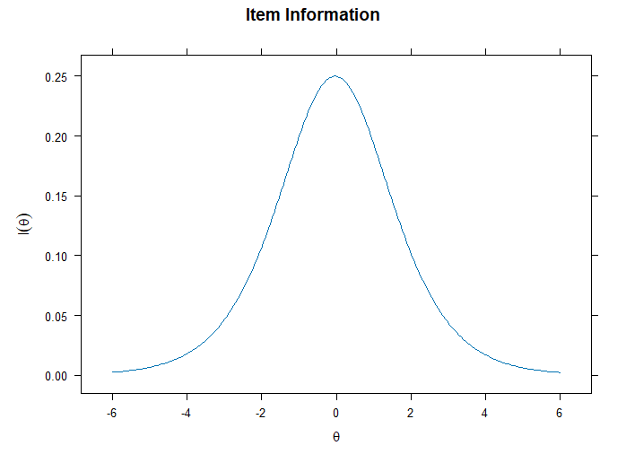{#fig-example_item_info}

This is quite useful because we can visually see where on the $\theta$ continuum the item is especially informative or which part on the $\theta$ continuum the item measures especially precisely.
Since we have already determined that the item information is greatest at the point of item difficulty (because that is where the ICC slope is steepest) and we know that the probability of a correct response at the point of item difficulty is 50% (because that is how item difficulty is defined), we can say that the maximum possible information in the Rasch model is 0.25 (because $I_i(\theta = \beta_i) = 0.5 \cdot 0.5 = 0.25$) and lies at the point of item difficulty.
Therefore, the peak of the item information curve always corresponds to the item's difficulty level.

The concept of item information as a measure of the (in)accuracy with which an item measures differs from CTT, and this is one advantage of IRT over CTT.
This is because in the CTT we have reliability as a measure of precision.
However, in CTT the reliability of an item is the same across the whole $\theta$ continuum.
This implies that an item can measure at every $\theta$ level equally well.
However, this is rather unrealistic: For example, consider an "easy" environmental concern item from the ECo scale.
This item is challenging to agree with for persons with low environmental concerns and not everyone will respond to this item with a 1, so we can differentiate between people at the lower end of the environmental concerns continuum.
However the same item is easy to agree with for persons with high environmental concerns.
So every person with high environmental concerns will agree with this item.
However if we compare only people who have high environmental concerns, an easy item does not differentiate between those people because every person agrees with it (i.e., all respond with a 1).
However, the CTT's reliability concept would suggest that a easy environmental concern item measures people with high environmental concerns just as well as it does for people with low environmental concerns.
In IRT, this is viewed more realistically based on item information, since each item can only accurately measure certain areas of a construct.
Put differently, in IRT the reliability varies over $\theta$ [@hoffmanLectureNotesFactor2024].

#### Test Information

Most of the time we don't have a single item but a whole scale consisting of multiple items.
Since we learned that the item information is the largest around the item difficulty and the difficulty may vary from item to item, we could ask ourselves how the scale as a whole can differentiate between persons across the whole $\theta$ continuum.
One metric that reflects this is the test information.

Since each item contributes some information, we can calculate the total test information by summing up the item information of all items [@deayalaTheoryPracticeItem2022, p.31].
Formally, this can be expressed as follows:

$$I(\theta) = \sum_{i=1}^I I_i(\theta)$$ {#eq-testinfo}

If we calculate the test information for every possible $\theta$ value with @eq-testinfo and plot the $\theta$ on the x-axis and the test information on the y-axis, then we get the *Test-Information curve* (see @fig-example_ICC_test_info for an example) .

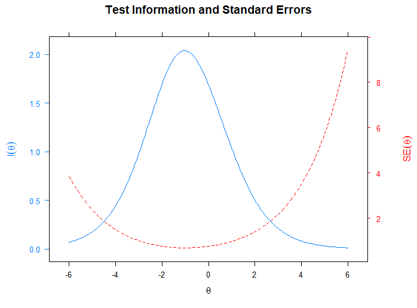{#fig-example_ICC_test_info}

Information is a measure of precision, and accordingly, it is also related to measures of imprecision.
Therefore, the test information is also related to the standard error.
Formally, this can be expressed as follows [@hoffmanLectureNotesFactor2024; @meiserBB2NeueEntwicklungen2025; @deayalaTheoryPracticeItem2022, p. 31]:

$$\mathit{SE}(\theta) = \frac{1}{\sqrt{I(\theta)}} = \frac{1}{\sqrt{\sum_{i=1}^I I_i(\theta)}}$$

This also makes intuitive sense, as we can see in @fig-example_ICC_test_info: At the $\theta$ areas where we measure very precisely (a lot of test information), we logically measure with less uncertainty (smaller standard error), and vice versa.

The test information again demonstrates an interesting difference to CTT: In CTT, reliability always depends on the exact composition of the scale.
The contribution of an item to reliability/validity always depends on which other items it is measured alongside [@lordApplicationsItemResponse1980, p. 22].
In IRT, on the other hand, the information contribution of an item is independent of the other items included in the scale.
Despite these differences between CTT and IRT, the test information can also be converted into a reliability metric [@hoffmanLectureNotesFactor2024, p. 41]:

$$\text{Reliability} = \frac{I(\theta)}{I(\theta) + 1}$$

For a more formal derivation of the reliability formula see @lordApplicationsItemResponse1980 [p. 52].
However, it is important to note that this reliability measure is again $\theta$-specific, since the test information is $\theta$-specific.
To obtain a measure of overall model-based reliability, one could sum the reliabilities for each possible $\theta$ value and weight them by the number of individuals at that $\theta$ level [@hoffmanLectureNotesFactor2024].
@hoffmanLectureNotesFactor2024, however, questions the value of such an approach, since it negates the very advantage that an IRT-based perspective provides [see also @lordApplicationsItemResponse1980].

#### Practical Use of Information

Item and test information can be very useful and insightful for diagnosticians and in scale development, as it allows us to assess at a glance how well—and in which areas—our items or scale are able to estimate the latent construct $\theta$ [see also @deayalaTheoryPracticeItem2022 for an illustration of this point].
We can understand this by looking at the fictional example shown in @fig-usecase_info .
Here we have a scale consisting of 5 items, for which we know the item difficulties: $\beta_1 = 0$, $\beta_2 = 1$, $\beta_3 = 3.5$, $\beta_4 = -1.5$ and $\beta_5 = -3.5$.
This allows us to determine and plot the item information and test information for all possible values of $\theta$.
As we've learned, an item can best differentiate between individuals within the area around its item difficulty, and therefore most of the information about that item is also found within that same area.
We can see this clearly in the figure.
Take, for example, Item 5, which can be described as an easy item because it has a very low $\beta$.
Accordingly, we can see in the pink item information curve for this item that the peak of the curve (i.e., the most information) occurs at the item difficulty $\beta_5 = -3.5$ and then decreases toward the sides.
We can now clearly see that Item 5 is well-suited for assessing individuals with a low $\theta$ around -3.5, but that this item provides us with hardly any information about individuals with high $\theta$ values.
For example, the item information for Item 5 is effectively 0 for a person with $\theta_n = 2.5$.
In other words, Item 5 contributes nothing to our knowledge about a person with $\theta_n = 2.5$.

For Item 3, the exact opposite is true.
This item is a difficult item ($\beta_3 = 3.5$) and is therefore particularly effective at distinguishing between high $\theta$ scores.
So if we want to measure individuals with high $\theta$ scores, Item 3 is the better choice than Item 5.
However, this comes at the cost of Item 3 not being suitable for measuring individuals with low $\theta$ scores, as we can see from the very flat item information curve in low $\theta$ areas.

Fortunately, we usually don't measure a latent construct using just a single item, but rather use a scale based on multiple items.
Therefore, we do not need to find a single item that can measure all $\theta$ ranges simultaneously with a high level of information (which is an unrealistic assumption).
Instead, we can consider the purpose for which we want to develop our measurement instrument.
For example, suppose we want to develop a measurement instrument that can be used for the general population.
For many constructs, it is assumed that they are normally distributed within the population.
This means that most individuals tend to have average scores on the construct (medium $\theta$ scores), but there are also some individuals with scores well above and well below average (low and high $\theta$ scores).
Therefore, our instrument must be capable of covering a broad $\theta$ continuum.
The five items from @fig-usecase_info would serve as a good measurement tool for this purpose, since we can see in the plot that the item information curves actually cover the entire relevant $\theta$ scale (from -5 to 5), as the scale contains items with very different $\beta$ values.
The black test information curve also summarizes this well.
Here we see that, overall, the scale has the most information around $\theta = 0$ and that the information decreases toward the sides.
Thus, the shape of the test information curve also resembles the distribution we assume in our population (normal distribution).
Of course, it should be noted here that this is an ideal example based on simulated data.

Therefore, let's consider another scenario.
Let's imagine we want to develop a measurement tool designed exclusively for people with high $\theta$ values.
This could be, for example, an intelligence test specifically for highly gifted individuals.
For such a scenario, the fictitious scale from our example is not optimal.
For example, Items 5, 4, and 1 contribute very little to the estimation of $\theta$ in our target continuum range.
In fact, only Item 3 differentiates particularly well in high $\theta$ areas.
The test information curve also drops quite steeply starting at $\theta = 2.5$.
So we would actually need additional items with high item difficulty (high $\beta$) to obtain more information in the high $\theta$ ranges.
In return, we could eliminate items that provide information for $\theta$ ranges that do not actually interest us (such as Items 5, 4, and 1).
Therefore, as @hoffmanLectureNotesFactor2024 notes, there is no universally “ideal” test information curve, since the optimal test information curve always depends on the purpose for which the measuring instrument was designed.

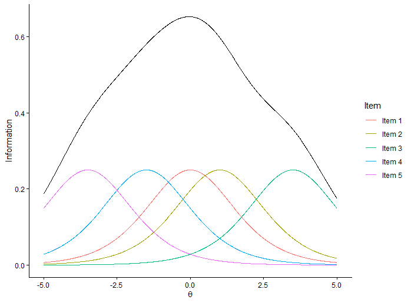{#fig-usecase_info}

The idea that the items should be distributed across the $\theta$ continuum that we want to measure should already be familiar to us.
In fact, we’ve already seen this point with the Wright map in @sec-wright-map .
In the Wright map, we also compared how item difficulties were distributed relative to the histogram of the person parameters.
In doing so, we were already implicitly considering the item information, because, as we now know, most of an item’s information is concentrated around its difficulty.
The information curves give us an even more detailed picture, since the entire information distribution is now plotted, not just the point of maximum information (i.e., $\beta_i$).

These examples should highlight the advantage of IRT over CTT.
Because the item and respondent parameters are located on the same latent scale and we can determine the information relative to the $\theta$ values, we get a much more nuanced picture of our measurement instrument and for whom it works particularly well.
From a scale development perspective we can adapt the design of our measurement instrument in a highly individualized and flexible manner to the specific requirements of the measurement situation [@deayalaTheoryPracticeItem2022, p. 35].

Thus, IRT can be used to:

- optimize existing scales: e.g., by "filling" the information gaps by adding new items that are informative for a specific $\theta$ range.
  Here, too, the ECo scale is a good example.
  In fact, optimizing the measurement was one of the motivations behind the development of the ECo scale, since analyses of existing measurement instruments for environmental concerns had shown that these provided little information in areas of high environmental concern [@gommHowMeasureEnvironmental2026, Figure 1 and Figure 2].

- create short versions of scales without a substantial loss of information: e.g., we might see in the item information plot that the information curves for two items overlap considerably.
  Therefore, we can omit one of the items, since the $\theta$ range is already covered.

- develop measurement instruments specifically tailored to a particular situation or target population.
  To this end, @lordApplicationsItemResponse1980 [p.23] suggests using a target information curve: To do this, you need an item pool for which you already know the item information curves.
  You also need to consider the test information curve you want to achieve with your scale (e.g., a curve focused on a specific $\theta$ range or a curve that covers a broad continuum).
  This desired curve is the target information curve.
  You can then begin selecting items from the item pool that can fill the area under the target information curve.
  To do this, after each step, you calculate the test information curve obtained from the selected items and compare it with the target curve.
  In the next step, you then try to select a new item that brings you even closer to the target curve.
  For example, if one observes that the current items only cover the low $\theta$ range well, but high $\theta$ values should also be differentiated below the target information curve, then one could add a difficult item (high $\beta$) in the next step to fill this “gap” relative to the target information curve.
  This process is repeated iteratively until a scale has been composed that comes as close as possible to the target information curve.

::: {.callout-note appearance="simple"}
## Let's do it in R

To plot the item information, we can use the functions we're already familiar with from the ICCs: With `itemplot()`, we get the information curve for a specific item, while with `plot()` we can plot the information curves for all items together in a single plot.
What's new here is that we're selecting a different option in the `type` argument.
Instead of “trace” for the ICC, we're now selecting "info" (for the `itemplot()` function) or “infotrace” (for the `plot()` function) to plot the item information.

```{r}
# plot item information curve of a specific item
itemplot(eco_rasch,6, type='info')

# plot all item information curves in a grid
plot(eco_rasch, type="infotrace", theta_lim=c(-5,5), facet = TRUE)

# plot all item information curves in a single plot
plot(eco_rasch, type="infotrace", theta_lim=c(-5,5), facet = FALSE)
```

To plot the test information curve, we can also use the `plot()` function:

```{r}
# plot test information curve
plot(eco_rasch, type="info")
```

We can also combine different types of information.
To do this, we can look at the various options offered by `type`.
For example, we can use “infoSE” to plot both the information curve and the standard error, or use “infotrace” to plot both the information and the ICC.

```{r}
# plot test information curve with SE
plot(eco_rasch, type="infoSE")

# plot item information curve of a specific item together with ICC
itemplot(eco_rasch,6, type='infotrace')
```
:::

## 2PL

In the Rasch model we basically assume that all differences between responses can be explained by the discrepancy between the person parameter $\theta$ and the item difficulty $\beta$.
In a regression logic this discrepancy is our only predictor, to predict the responses of a person on an item.

But perhaps the assumption that only the person parameter and the item difficulty influence the response probability is a little too strict.
Maybe there are other predictors which also influence the response probabilities.
For example, a further predictor could be the ability of an item to "differentiate among individuals located at different points on the continuum" [@deayalaTheoryPracticeItem2022, p.137].
This is also called *discrimination.* From the Rasch model we are already familiar with this idea and know that this has something to do with the slope of the ICC.
However, in the Rasch model the slopes of the different items were all fixed at 1, which results in parallel ICCs.
This means that all items differentiated to the same degree between persons.
The only difference was where on the $\theta$ continuum they differentiated but they all differentiated equally "strongly".
If we relax this assumption, we can now allow that different items can differentiate to varying degrees.
Therefore, we get a new property of the items, which we can use as a predictor to predict the response probability of a person on an item.

By adding this new item property to our prediction framework (i.e., our model), we now have two item-specific parameters in our model (item difficulty & discrimination).
This is an extension to the Rasch model, which has only one item-specific parameter (= 1PL).
Therefore, this new extension is called (Birnbaum) *two-parameter logistic model* (2PL).

### Model Formula

The model equation of the 2PL looks quite similar to that of the Rasch model.

$$\begin{align}
P(Y_{ni} = 1) = \frac{\exp(\alpha_i(\theta_n - \beta_i))}{1 + \exp(\alpha_i(\theta_n - \beta_i))}
\end{align}$$ {#eq-2PL}

Let’s take a look at the individual components to better understand the formula:

On the left side of the equation is again the probability that a person $n$ will answer item $i$ with a 1 ($P(Y_{ni} = 1)$).
Thus, $Y_{ni}$ denotes the response of person $n$ to item $i$ .
As in the Rasch model, the 2PL also assumes dichotomous response data, so $Y_{ni}$ can take the values 0 or 1.
To predict this probability $P(Y_{ni} = 1)$ we again use the person parameter $\theta_n$ and the item difficulty $\beta_i$.
What is new is the additional parameter $\alpha_i$, which represents the item discrimination.
Note that the item discrimination parameter is item-specific, as we can see by the index $i$ of the $\alpha$ parameter (Note that this is also the difference to the 1PL model as displayed in @eq-1PL. Although this equation also contains an $\alpha$, it does not have the index $i$, since in the 1PL, $\alpha$ is the same for all items.) [Check where the 1PL section is located in the final draft]{.mark}.
This means that under the 2PL each item can have a different $\alpha_i$ value.

Here we can also see that the Rasch model is a special case of the 2PL where the item discrimination of every item is 1.
Formally speaking:

$$\alpha_i = 1 \quad \forall\, i \in \{1, \ldots, I\}$$

We can also see this in the output of the Rasch model (@lst-rasch-item-param).
The `a` column reflects the $\alpha_i$ values and as we can see, they are all 1 in the Rasch model.

### Interpretation of the Item Discrimination Parameter

If we ignore the link-function for a moment, which is there solely to ensure that our model outputs values in the interval of (0,1) to ensure a metric compatible with probabilities, then we are left with a linear term.
If we rewrite the formula we can see that this is basically a linear regression [@debelakIntroductionRaschModel2022]:

$$\alpha_i(\theta_n - \beta_i) = \alpha_i\theta_n - \alpha_i\beta_i$$

If we define a new variable $\gamma_i = -\alpha_i\beta_i$ then we can write:

$$\alpha_i\theta_n + \gamma_i$$

Now we can see that this looks like a simple linear regression, where $\theta_n$ is the predictor and $\gamma_i$ is the intercept.
More importantly, we can now see that the new item discrimination parameter $\alpha_i$ works as the slope of the function.

We can also see this in the ICCs of a 2PL model.

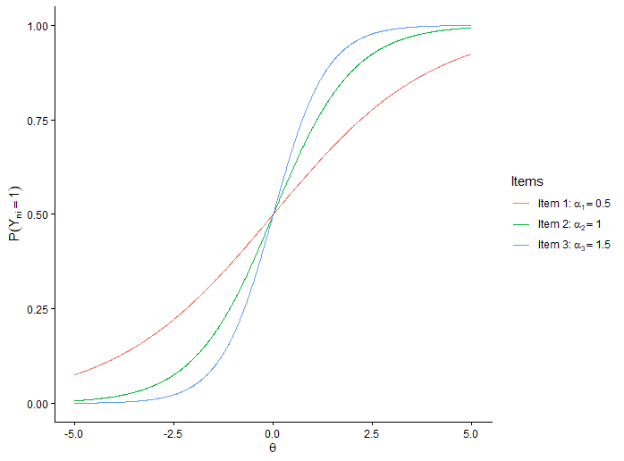{#fig-2PL-ICC-example-alphas}

As one can see, the more the $\alpha_i$ parameter increases, the steeper is the slope of the ICC around the item difficulty $\beta_i$.
The other way around, the smaller the $\alpha_i$ parameter gets, the flatter the ICC becomes.

But how can we interpret the $\alpha_i$ parameter in terms of its meaning?
We already learned that the $\alpha_i$ parameter is also called item discrimination.
So what does discrimination actually mean?

Technically we already know this from the information section of the Rasch model (see @sec-Information).
There we learned that the steeper the slope of the ICC the better we can differentiate between two persons with $\theta_n$ values close to each other.
We also learned that an item can differentiate the best around the item difficulty $\beta_i$ because that is where the point of inflection lies and the slope of the ICC is the steepest.
But we've always illustrated this using just a single item (with an $\alpha_i = 1$).
So let's now consider what happens when items differ in their slope.

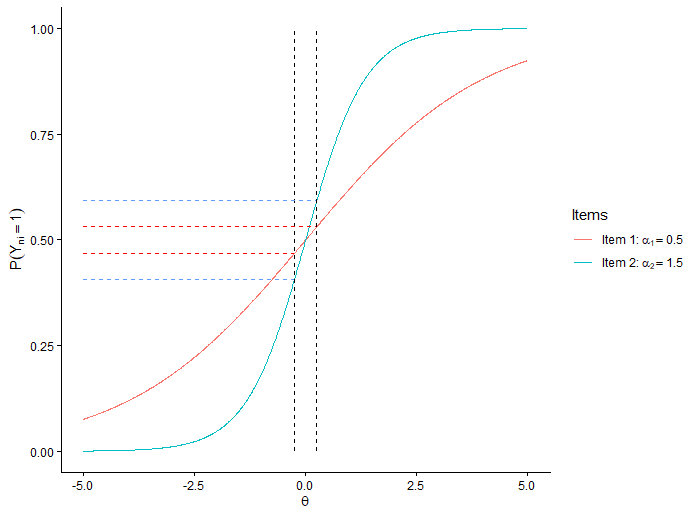{#fig-2PL-expl-discr}

In @fig-2PL-expl-discr we can see two different items with different $\alpha_i$ parameters but the same item difficulty $\beta_1 = \beta_2 = 0$.
Now imagine we have two Persons with very similar $\theta_n$ values, e.g., two persons with a similar amount of environmental concerns.
Let's say Person 1 has a $\theta_1 = -0.25$ and Person 2 has a $\theta_2 = 0.25$.
Both persons, therefore, fall within a range close to the difficulty levels of the two items—that is, a range in which the two items can best distinguish between persons.
So even though the two persons are located in the optimal $\theta$ range for both items, we can see that Item 2 is considerably better at distinguishing between the two persons than Item 1.
This is because Item 2 has a much steeper slope around the item difficulty than Item 1.
This results in larger differences in the model implied probabilities, that the person will answer the item with a 1, between the persons.
We can see this in the dashed lines in @fig-2PL-expl-discr.
The blue dashed lines are further apart from each other than the red ones.
A larger difference in the probabilities of answering the item with a 1 means that the model can more clearly separate the two persons, in the sense that the respondents’ answers are more likely to differ.
The probability that Person 2 will answer with a 1 and Person 1 will answer with a 0 is greater for Item 2 than for Item 1.
Therefore, Item 2 has better discriminative power and we learned that "the magnitude of the difference in these predicted probabilities is a direct function of the item's $\alpha$" [@deayalaTheoryPracticeItem2022, p. 20].

::: {#tip-math-loadings .callout-tip appearance="simple"}
## Mathematical Background

**Discrimination and Item-Total Correlation**

Note that the discrimination parameter in IRT relates also to the item-total correlation from CTT, which is also sometimes called item discrimination [@lordApplicationsItemResponse1980, p. 33]:

$$\alpha_i \approx \frac{\rho_{ix}}{\sqrt{1-\rho_{ix}^2}} \quad ; \quad
\rho_{ix} \approx \frac{\alpha_i}{\sqrt{1+\alpha_i^2}}$$

However, this mathematical relationship holds only if $\theta$ is restricted to a standard normal distribution and there is no guessing involved [@lordApplicationsItemResponse1980].

**Discrimination and factor loadings**

As we already learned, IRT models are basically generalized linear mixed models.
It is a model where we want to predict a dichotomous dependent variable and we use latent predictors for this.
If we have a continuous dependent variable and we predict it with a latent predictor, we call this *confirmatory factor analysis* (CFA).
We also know that we can use link-functions to deal with dichotomous dependent variables as we do for example in logistic regressions.
So basically, we can think of IRT models as CFA for categorical responses, where we use a link function to deal with the dichotomous response format [@hoffmanLectureNotesFactor2024].

Please note that the following part is taken from @hoffmanLectureNotesFactor2024

So if we transform our dependent variable according to our link-function (logit-link), we can use the same formula as in CFA:

$$\text{Logit}[p(y_{ni} = 1)] = \mu_i + \lambda_iF_n$$

This looks very different from our 2PL model equation (see @eq-2PL).
However, it's just a different way of writing it, and all of our components from 2PL are already included here: The intercept $\mu_i$ reflects item easiness.
Writing it as $\mu_i = -\tau_i$ gives the item threshold $\tau_i$.
Note that $\tau_i$ is not yet the item difficulty.
In the 2PL, the difficulty is obtained by dividing the threshold by the loading, $\beta_i = \tau_i/\lambda_i$.
The $\lambda_i$ is the factor loading and corresponds to the item discrimination.

We can show this by rearranging the 2PL formula:

$$\begin{align}
P(Y_{ni} = 1) &= \frac{\exp(\alpha_i(\theta_n - \beta_i))}{1 + \exp(\alpha_i(\theta_n - \beta_i))}\\
P(Y_{ni} = 1) &= \text{Logit}^{-1}[\alpha_i(\theta_n - \beta_i)]
\end{align}$$ {#eq-2PL-CFA}

Now, if we multiply out the linear term and rearrange a bit, we get:

$$\begin{aligned}
\text{Logit}^{-1}[\alpha_i(\theta_n - \beta_i)] &= \text{Logit}^{-1}[\alpha_i\theta_n -\alpha_i\beta_i]\\
&= \text{Logit}^{-1}[-\alpha_i\beta_i + \alpha_i\theta_n]
\end{aligned}$$

If we focus only on the expression inside the brackets, we can see we get a constant $-\alpha_i\beta_i$ because this term has only the index $i$ and varies only over items but not within item.
Next we have a slope parameter $\alpha_i$ and a latent predictor $\theta_n$.
This looks pretty much like a linear term from a regression.
In fact, this translates directly into the formula of a CFA:

$$-\alpha_i\beta_i + \alpha_i\theta_n = -\tau_i + \lambda_iF_n$$

As one can see, the model parameters of the 2PL model correspond to those of the CFA ($\alpha_i = \lambda_i$ and $-\alpha_i\beta_i = -\tau_i$; rearranged we get $\beta_i = \tau_i/\lambda_i$) , and ultimately, the 2PL and CFA formulas are simply two different notations/parameterizations for the same model.
However, this holds only if the latent construct ($\theta$ or $F$) has the same metric in the 2PL as in the CFA.
In IRT $\theta$ is often restricted to a standard normal distribution $N(0,1)$.
In contrast, in CFA, often times the loading of one anchor item is fixed at 1 and the variance of the latent trait can be estimated freely.
In such a case the variance of the latent trait of the CFA is different from the latent trait in the 2PL model.
Furthermore, the mean of the latent trait can be different.
In the 2PL it is restricted to 0 but in the CFA it can be estimated freely.

[I changed it to the inverse logit notation. However, I personally find it more intuitive if on the right side are the logg odds and on the left side is the linear term. Because I think for beginner the Inverse Logit is intimidating and distracting and the main point here is to show the equivalence of the linear terms of CFA and 2PL. Maybe this is a good point to ask Florian, which notation he finds more intuitive]{.mark}

We can calculate the 2PL parameters from the CFA parameters nonetheless if we account for this.
We just have to map the CFA parameter onto the scale of the 2PL.
This can be done with the following equations:

$$\begin{aligned}
\alpha_i &= \lambda_i \cdot \sqrt{\sigma_{F}^2}\\
\beta_i &= \frac{\tau_i - (\lambda_i \cdot \overline{F})}{\lambda_i \cdot \sqrt{\sigma_{F}^2}}
\end{aligned}$$

The equation for the $\alpha_i$ relates to the slope.
The slope expresses how much the outcome changes, if we increase the predictor by one unit.
In the 2PL one unit equals one standard deviation which is 1 under a standard normal distribution.
However, in the CFA, one unit equals the standard deviation of the latent trait $\sqrt{\sigma_{F}^2}$.
Therefore, one unit is in the CFA metric $\sqrt{\sigma_{F}^2}$ times greater than in the 2PL metric.
Consequently, we also have to increase the slope $\lambda_i$ by this factor to bring it to the 2PL metric.

When we take a look at the item difficulty $\beta_i$, the right-hand side of the formula looks a little bit like the formula for z-standardization and this is basically the idea here.
We want to calculate how far the item difficulty lies from the mean of the latent construct to place it accordingly on the 2PL scale.

Note that if the latent trait in the CFA also follows a standard normal distribution the equations simplify to the 1:1 mapping:

$$\begin{aligned}
\alpha_i &= \lambda_i \cdot \sqrt{1} = \lambda_i \cdot 1 = \lambda_i\\
\beta_i &= \frac{\tau_i - (\lambda_i \cdot \overline{F})}{\lambda_i \cdot \sqrt{\sigma_{F}^2}} = \frac{\tau_i - (\lambda_i \cdot 0)}{\lambda_i \cdot \sqrt{1}} = \frac{\tau_i}{\lambda_i}
\end{aligned}$$

Of course, we can also do this the other way around to bring the 2PL parameters to the scale of the CFA by simply rearranging the formulas:

$$\begin{aligned}
\lambda_i &= \frac{\alpha_i}{\sqrt{\sigma_{F}^2}}\\
\tau_i &= \alpha_i\beta_i + \frac{\alpha_i \cdot \overline{F}}{\sqrt{\sigma_{F}^2}}
\end{aligned}$$

Note, however, that these equations only hold if the latent trait is standardized in the 2PL metric (mean = 0, variance = 1).

For a more in-depth and formal discussion of this point see @kamataNoteRelationFactor2008 and the [Appendix](#sec-appendix2).
:::

```{r}
#| eval: false
#| include: false
# If we take a look at the 2PL formula, we can see that we predict the probability and not the Logit. Therefore, we apply the inverse of the link-function to the right hand side of the equation (see first formula in @eq-2PL-CFA). However, we can also use the 2PL parameterization to predict the Logit. Then we have only our linear term left on the right hand side of the equation (see second formula in @eq-2PL-CFA).
# 
# $$\begin{align}
# P(Y_{ni} = 1) &= \frac{\exp(\alpha_i(\theta_n - \beta_i))}{1 + \exp(\alpha_i(\theta_n - \beta_i))}\\
# \text{Logit}[p(y_{ni} = 1)] &= \alpha_i(\theta_n - \beta_i)
# \end{align}$$
#   
#   $$
#   P(Y_{ni} = 1) = \text{Logit}^{-1}[\alpha_i(\theta_n - \beta_i)]
# $$
#   
#   Now, if we multiply out the linear term and rearrange a bit, we get:
#   
#   $$\begin{align}
# \alpha_i(\theta_n - \beta_i) &= \alpha_i\theta_n -\alpha_i\beta_i\\
# &= -\alpha_i\beta_i + \alpha_i\theta_n
# \end{align}$$
#   
#   As we can see we get a constant $-\alpha_i\beta_i$ because this term has only the index $i$ and varies only over items but not within item. Next we have a slope parameter $\alpha_i$ and a latent predictor $\theta_n$. This looks pretty much like a linear term from a regression. In fact this translates directly in the formula of a CFA:
#   
#   $$-\alpha_i\beta_i + \alpha_i\theta_n = -\tau_i + \lambda_iF_n$$
```

::: {.callout-note appearance="simple"}
## Let's do it in R

To estimate the 2PL model we can also use the `mirt` package [@chalmersMirtMultidimensionalItem2012] and very similar syntax as with the Rasch model.

```{r}
# estimate a 2PL model:

eco_2PL <-  mirt(dat_eco_dicho[12:20], 
                 1, 
                 itemtype = "2PL",      # <1>
                 SE = TRUE)
```

1.  To estimate the 2PL model we can use the same code as for the Rasch model and just change the value in the `itemtype` argument from "Rasch" to "2PL".

We can use the `print()` function again to get a summary and some general information about our 2PL model with regard to the estimation procedure and the overall model fit.

```{r}
# get general estimation and fit information about our model:

print(eco_2PL)
```

A detailed description of how to interpret this output was already covered in the Rasch section of the tutorial and can be found there (see @lst-print-rasch).

Again we can also do a quick check of convergence by using the `converged` and `secondordertest` variables from our `mirt` object:

```{r}
# has the estimation algorithm converged?
eco_2PL@OptimInfo$converged

# has the estimation algorithm found plausible maximum/minimum
eco_2PL@OptimInfo$secondordertest
```

To inspect the item parameters we use the `coef()` function, as in the Rasch model

```{r}
# extract the item-specific parameters from our 2PL model

item_par_eco_2PL <- coef(eco_2PL, IRTpars=TRUE, simplify=TRUE)

item_par_eco_2PL
```

The output consists of the three sections we are already familiar with.
Note that, in contrast to the output of the Rasch model, we have now `a` values, which differ from 1.
This is because the `a` column in the `$items` section contains our $\alpha_i$ parameters.

To extract the person parameters ($\theta_n$) we can use the `fscores()` function.
Note, that to keep the output short, we are only printing the first six person parameters to the console by using `head()` .

```{r}
# extract the person-specific parameters from our 2PL model
person_par_eco_2PL <- fscores(eco_2PL)

head(person_par_eco_2PL)
```

We've also learned that IRT models are related to confirmatory factor analysis.
[Wurde das schon eingeführt oben?]{.mark}
Accordingly we can transform our IRT model parameters into standardized factor loadings (see also [mathematical background -@tip-math-loadings]).
To do this, we use the `summary()` function.

```{r}
# get factor loadings of our 2PL

loadings_2PL <- summary(eco_2PL)
```

The output is a table in which the rows represent the items.

- The standardized factor loadings are listed under `F1` (= Factor 1).

- The `h2` column contains the communalities, which indicate how much variance the factor explains in each item.

- The `SE.F1` column contains the standard errors.

- `SS loadings` is the sum of the squared loadings.

- `Proportion Var` is the proportion of variance explained across all items.

- Under `Factor correlations`, we find the correlations between the latent factors.
  Since our model has only one factor and the correlation of a variable with itself is 1, we logically have a 1 $\times$ 1 matrix here whose elements are 1.

As a proof that these loadings actually correspond to the loadings of a CFA see also the [Appendix](#sec-appendix2).

**Visualizations of the 2PL:**

Also for the ICCs we can use the same functions as with the Rasch model.

Therefore, to plot the ICC of a single item from our scale, we can use the `itemplot()` function.

```{r}
# plotting an ICC of a specific item

itemplot(eco_2PL,
         item = 6,
         type="trace")
```

To plot the ICCs of all items at the same time, we can use the `plot()` function.

```{r}
# plot all ICCs of a scale

plot(eco_2PL,
     type="trace",
     theta_lim=c(-5,5),
     facet = FALSE)

# plot all ICCs in a grid

plot(eco_2PL, 
     type="trace", 
     theta_lim=c(-5,5), 
     facet = TRUE)
```
:::

### Identifiability in the 2PL

We already learned about the identifiability problem in the Rasch model (see @sec-identi-Rasch).
The issue of additive indeterminacy also applies to the 2PL model.
Therefore, we also have to restrict the model to a specific origin to make the model identifiable.

However, in the case of the 2PL model, this is not enough because in addition to additive indeterminacy, there is also multiplicative indeterminacy.
This means, even if we restrict the model to a certain origin, the model is still not identifiable.
This is because latent traits also do not have a inherent metric/unit and therefore, the choice of metric is also arbitrary [@lordApplicationsItemResponse1980].
This aspect comes into play because, in the 2PL model, we now also have the $\alpha$ parameter.
As a result, it can compensate for the effect of a multiplicative constant (as we can see in the math section).

::: {.callout-tip appearance="simple"}
## Mathematical Background

**Multiplicative Indeterminacy** [@debelakIntroductionRaschModel2022; @lordApplicationsItemResponse1980]

If we multiply the $\theta_n$ and $\beta_i$ parameters by a constant $c$ and simultaneously divide the discrimination parameter $\alpha_i$ by the same constant $c$, the resulting probabilities that a person will respond to an item with a 1 are the same as for the untransformed parameters $\theta_n$, $\beta_i$ and $\alpha_i$.

$$\begin{aligned}
\theta_n' &= \theta_n \cdot c\\
\beta_i' &= \beta_i \cdot c\\
\alpha_i' &= \frac{\alpha_i}{c}
\end{aligned}$$

We can again predict the log odds instead of the probability to make the equation clearer:

$$\begin{aligned}
\ln \left(\frac{P(Y_{ni} = 1\mid\theta_n, \beta_i, \alpha_i)}{P(Y_{ni} = 0\mid\theta_n, \beta_i, \alpha_i)} \right) = \alpha_i(\theta_n - \beta_i)\\
\ln \left(\frac{P(Y_{ni} = 1\mid\theta_n', \beta_i', \alpha_i')}{P(Y_{ni} = 0\mid\theta_n', \beta_i', \alpha_i')} \right) = \alpha_i'(\theta_n' - \beta_i')
\end{aligned}$$

So let's see if the multiplication of $\theta_n$ and $\beta_i$ can be compensated if we divide the discrimination parameter by the same multiplicative constant, so that the log odds are the same as for the original parameter set.

$$\begin{aligned}
\ln \left(\frac{P(Y_{ni} = 1\mid\theta_n, \beta_i, \alpha_i)}{P(Y_{ni} = 0\mid\theta_n, \beta_i, \alpha_i)} \right) &= \ln \left(\frac{P(Y_{ni} = 1\mid\theta_n', \beta_i', \alpha_i')}{P(Y_{ni} = 0\mid\theta_n', \beta_i', \alpha_i')} \right)\\
\alpha_i(\theta_n - \beta_i) &= \alpha_i'(\theta_n' - \beta_i')\\
&= \frac{\alpha_i}{c}(\theta_n \cdot c - \beta_i \cdot c)\\
&= \frac{\alpha_i}{c} \cdot c \cdot (\theta_n - \beta_i)\\
&= \alpha_i \cdot \frac{1}{c} \cdot c \cdot (\theta_n - \beta_i)\\
&= \alpha_i \cdot \frac{1}{c} \cdot \frac{c}{1} \cdot (\theta_n - \beta_i)\\
&= \alpha_i \cdot \frac{c}{c} \cdot (\theta_n - \beta_i)\\
&= \alpha_i \cdot 1 \cdot (\theta_n - \beta_i)\\
&= \alpha_i (\theta_n - \beta_i)\\
\end{aligned}$$
:::

We can use the same restrictions as discussed in the Rasch model to make our model identifiable (see @sec-identi-Rasch).
Note that in the Rasch model the item discrimination $\alpha_i$ of every item is by definition 1, so in the Rasch model the multiplicative indeterminacy is already solved [@debelakIntroductionRaschModel2022].

[Did it even make sense to demonstrate rotation ambiguity for one-dimensional models? Maybe we should cover this in a tutorial on multidimensional models instead?]{.mark}

### Information in the 2PL

#### Item Information

In the Rasch model we already saw that the slope of the ICC of an item relates to its information and therefore to the precision of an item [see @sec-Information].
In the 2PL we learned that the $\alpha$ parameter influences the slope of the ICC and therefore $\alpha_i$ also relates to the information of an item.
The steeper the slope, the better we can distinguish between individuals, the more accurately we measure, and the greater the information we obtain.
Accordingly, a larger $\alpha$ also leads to more information.
As a rule of thumb, values of $\alpha$ ranging from 0.8 to 2.5 can be considered as "good" [@deayalaTheoryPracticeItem2022, p. 137].
However, this statement applies only to the $\theta$ range around the item difficulty $\beta_i$.
As we have learned, one advantage of IRT over CTT is the fact that it does not assume that an item can measure equally well across the entire $\theta$ continuum.
Therefore, it must also be noted that a higher $\alpha$ causes the measurement accuracy to be concentrated more strongly within a smaller $\theta$ range.
Within this range, we measure very accurately and “better”; in return, however, we get less information for the $\theta$ ranges outside this "high precision" range than we would with an item having a lower $\alpha$.

To make this point even clearer, we can use the example from @fig-2PL-expl-discr earlier again.
In this example, we looked at two similar individuals near the item difficulty and found that the item with the steeper slope—or higher $\alpha$—is better at discriminating, meaning it measures more accurately and contains more information.
Now let's take two more persons (Person 3 with $\theta_3 = 2.5$ and Person 4 with $\theta_4 = 3$) who are the same distance apart with regard to their $\theta$ scores as Person 1 and 2 in @fig-2PL-expl-discr, but who are farther away from the item difficulty.
This situation is displayed in @fig-2PL-expl-discr2 .
For these two new persons we can see that Item 1 actually differentiates better between the two persons than Item 2 although Item 2 has the higher $\alpha_i$.
We can see this because the red dashed lines are farther apart than the blue ones.
This means that the differences in the predicted response probabilities for Item 1 are greater than those for Item 2.
This shows once again that while a higher $\alpha$ can improve measurement accuracy, this improvement is also concentrated within a smaller $\theta$ range.

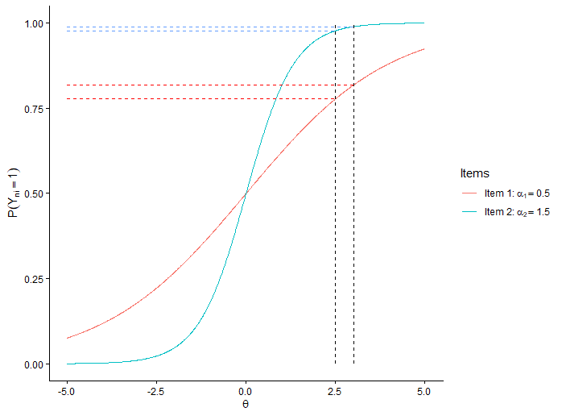{#fig-2PL-expl-discr2}

Note also that now the ICCs of the different items are no longer parallel to each other.
This means that the ICCs of different items can cross each other, illustrating that the property of specific objectivity does not hold anymore in the 2PL.
We have already discussed this scenario in @fig-ICC_spec_obj_2PL.

::: {.callout-tip appearance="simple"}
## Mathematical Background

We can also see the effect of $\alpha_i$ on the information in the mathematical formula for item information

$$\begin{aligned}
I_i(\theta) &= \alpha_i^2 \cdot p(X_i = 1) \cdot p(X_i = 0)\\
&= \alpha_i^2 \cdot \frac{\exp(\alpha_i(\theta - \beta_i))}{1 + \exp(\alpha_i(\theta - \beta_i))} \cdot \frac{1}{1 + \exp(\alpha_i(\theta - \beta_i))}
\end{aligned}$$

We can also see from this that, contrary to the Rasch model, the maximum item information can exceed 0.25.
We know that the maximal item information is at the point of the item difficulty.
Since the item difficulty is defined as the point on the $\theta$ scale where the probability of answering the item with a 1 is 50% we get for the point of the item difficulty:

$$I_i(\theta = \beta_i) = \alpha_i^2 \cdot 0.5 \cdot 0.5 = \alpha_i^2 \cdot 0.25$$

As we can see in the 2PL the 0.25 is additionally weighted by the squared item discrimination $\alpha_i^2$.
Consequently, if $\alpha_i > 1$, then the maximal possible item information is greater than 0.25.
Conversely, if $\alpha_i < 1$, then the maximal possible item information is smaller than 0.25.
:::

In summary, we learned that in the 2PL the item information now depends on two factors:

1.  The distance of the person to the item difficulty ($\theta_n - \beta_i$)

2.  the discrimination parameter $\alpha_i$ (the higher the discrimination, the higher the information around the item difficulty)

#### Test Information

As in the Rasch model, the test information is simply the sum of item information over all items:

$$I(\theta) = \sum_{i = 1}^II_i(\theta)$$

::: {.callout-tip appearance="simple"}
## Mathematical Background

Mathematically, the test information is based on Fisher's information [@fischerRaschModelsFoundations1995; @debelakIntroductionRaschModel2022, p. 51]:

$$I(\theta_n) = -E\left(\frac{\partial^2 \ln P(\mathbf{Y}_n = \mathbf{y}_n \mid \theta_n, \boldsymbol{\beta})}{\partial^2 \theta_n}\right)= \sum_{i=1}^{I} P(Y_{ni} = 1 \mid \theta_n, \beta_i) \cdot P(Y_{ni} = 0 \mid \theta_n, \beta_i)$$

Please note that some symbols in the equation are in bold, indicating that they represent vectors.
This is because we are calculating the test information, meaning we want to consider the information across all items on the scale.
Accordingly, for example, the vector $\mathbf{y}_n$ contains all of the item responses for person $n$, and the vector $\boldsymbol{\beta}$ contains the item difficulties for all items on the scale.

From the $\partial^2$, we can see that this includes the second derivative of the log-likelihood.

Simply put, the log-likelihood is the criterion we optimize during parameter estimation.
You can think of it something like this: We define a model (e.g., the Rasch model or 2PL).
This determines the form or structure, since the model must “adhere to” the model equation.
However, the model equation consists of parameters that are variable.
We can plug in different values here.
This raises the question of which values we should use for our parameters to best fit the model to our observed data.
One possible approach to finding this out is to simply plug in some arbitrary values for the parameters and see how well our model predicts the data with these parameters.
Then we try out different parameter values until we find the best “settings” for the parameters to predict the data.
Of course, this is a simplification of the actual estimation algorithms, but the exact procedure of parameter estimation is not covered in this tutorial.
The point that's relevant here is that we need some kind of quantifiable measure of “how well the model can predict the data” so that our model knows whether the new parameter values are better or worse than the previous ones.
This is exactly what we use the log-likelihood for, because the log-likelihood is, by definition, the logarithm of the probability of the observed data given certain parameter values.
This allows us to establish a clearly definable criterion that an algorithm can optimize.
Specifically, we can instruct the algorithm to try out different parameters until it finds the ones that maximize the log-likelihood.
If this reminds you of the term “maximum likelihood,” you’re absolutely right.

For simplicity’s sake, let’s imagine that our model has only one parameter that we’re trying to estimate.
Then, for each possible parameter value, we could calculate the log-likelihood and create a plot (see @fig-expl-info-2PL).
The x-axis would show the parameter values, and the y-axis would show the log-likelihood.
We want the parameter value (x-value) that has the highest log-likelihood (y-value).
Graphically speaking, we are looking for the peak of the graph.
So, once we identify the maximum, we obtain an estimator for our parameter that best fits our data (given the model structure we provide).
We now not only know our model structure but also have exact values for our model parameters ($\theta_n$ and $\beta_i$).

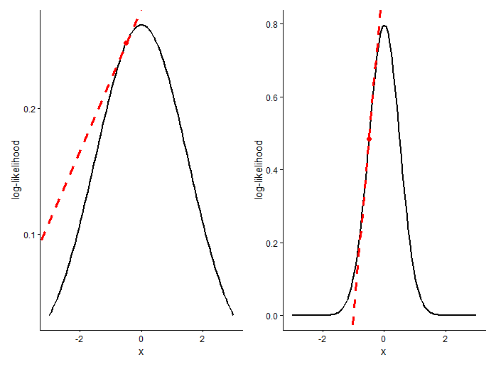{#fig-expl-info-2PL}

But how does this all relate to the information and how does the second derivative come into play?
Let's remember, information is a measure of measurement precision.
Therefore, we could ask, how certain we are that the parameter values we estimated based on the log-likelihood are the best or true solution of the estimation problem?
To answer this question we have to ask a different question: When is it easy to find the maximum value of the log-likelihood?
It's easy to find the highest point when we have a distinct or pointed peak.
If the peak is relatively broad and flat, there are many parameter values that can produce similarly high log-likelihood values but are not the optimal parameter values.
So we want a sharp, clearly recognizable peak.
We find this when the slope rises steeply before the maximum and drops steeply again after it.
However, if the slope rises rather gently before the maximum and also drops rather gently afterward, then we end up with a broader peak.
As we learned in school, the first derivative quantifies the slope of our log-likelihood function.
This we can also see in @fig-expl-info-2PL .
In the right plot we have a more peaked maximum and accordingly we see that the first derivative (red dashed line) is much steeper than in the plot on the left.
Accordingly, the second derivative indicates the slope of the first derivative.
This can be interpreted in terms of acceleration or curvature.
The faster the slope of our log-likelihood function increases, the greater the differences in the first derivative between the x-values around the maximum, which means that the slope changes rapidly over a small range.
This means we have a relatively high rate of change, which is reflected in large absolute values of the second derivative.
If the log-likelihood rises slowly around the maximum, the situation is exactly the opposite, and the values of the second derivative are relatively small.
Accordingly, we can use the second derivative to estimate how sharp the peak of our function is and, consequently, how confident we can be in our parameter estimate.
Now it should also become clear why it makes sense for the formula for information to be based on the second derivative.

[Please note, that this intuitive explanation is based on a lecture of @meiserBB2NeueEntwicklungen2025]{.mark}.
:::

::: {.callout-note appearance="simple"}
## Let's do it in R

Here, too, we can essentially use the exact same code blocks as we did with the Rasch model.
We just need to make sure to pass the 2PL model object to the functions instead of the Rasch model.

To plot the information curve of a single item we can use the `itemplot()` function.

```{r}
# plot item information curve of a specific item

itemplot(eco_2PL, 6, type='info')
```

To plot all item information curves at the same time, we can use the `plot()` function.

```{r}
# plot all item information curves in a single plot
plot(eco_2PL, type="infotrace", theta_lim=c(-5,5), facet = FALSE)

# plot all item information curves in a grid
plot(eco_2PL, type="infotrace", theta_lim=c(-5,5), facet = TRUE)
```

To plot the test information curve we can also use the `plot()` function.

```{r}
# plot test information curve
plot(eco_2PL, type="info")
```

We can also combine different types of information.
To do this, we can look at the various options offered by `type`.
For example, we can use “infoSE” to plot both the information curve and the standard error, or use “infotrace” to plot both the information and the ICC.

```{r}
# plot test information curve with SE
plot(eco_2PL, type="infoSE")

# plot item information curve of a specific item together with ICC
itemplot(eco_2PL,6, type='infotrace')
```
:::

### Model Comparison

We've now looked at two models: the Rasch model and the 2PL model.
But how do I know which model to choose?
This is a complex question—one that could probably be the subject of a tutorial all its own—and for which there is no single, clear-cut answer.
The “right” model can mean something quite different depending on the researcher’s motivation.
If you have a clear theoretical expectation that you want to test, then the model is determined by that alone, and you’re interested in whether this assumption or model can be upheld based on the observed data.
However, one might also aim to make the best possible predictions and then select the model accordingly.

Therefore, we can rephrase and clarify the question somewhat: How do I know which model fits my data better?

For this we can use model comparison methods.
There are different methods to choose from and they all have different advantages and assumptions.

#### Likelihood Ratio Test

This is an inferential statistical test that can be used to compare two models in terms of their fit [see also @deayalaTheoryPracticeItem2022, p.198].
However, this test can only be applied to hierarchically related (nested) models.
This means that the two models being compared must be convertible into one another—or, in other words, one model must be a special case of the other.
Therefore, there is always a more complex model and a simpler model that can be derived from the restriction of the more complex model.
We are already familiar with this from our Rasch model and the 2PL.
We have already seen that if we fix the $\alpha_i$ parameters in the 2PL to 1 for all items, we obtain the Rasch model.
In this sense, the Rasch model is a special case of the 2PL model.
In other words, the Rasch model is less complex than the 2PL because it has fewer free parameters than the 2PL, since the $\alpha_i$ values cannot change in the Rasch model.
So we have nested models here and can therefore apply the likelihood ratio test to compare the Rasch model with the 2PL.

The likelihood ratio test is based on the likelihood, which is a measure of how well the model can predict the data or how well the model fits the data.

The test statistic can be calculated using the following formula:

$$-2\Delta\ln(\mathit{L}) = (-2\ln(\mathit{L}_\text{S})) - (-2 \ln(\mathit{L}_\text{C}))$$

Simply put, we are comparing the fit of the simpler model ($S$) to the data with the fit of the more complex model to the data ($C$).
Since we are calculating a difference ($\Delta$), we are looking at how much better the more complex model fits the data than the simpler model.

The convenient thing is that this test statistic, $-2\Delta\ln\mathit{L}$, follows a $\chi^2$ distribution, so we can use it to perform a significance test.
The number of degrees of freedom ($\mathit{df}$) is the difference in the number of freely estimated parameters between the more complex model ($C$) and the simpler model ($S$).
Put differently, the degrees of freedom are the number of restricted parameters of the simpler model compared to the more complex model.
Formally:

$$\begin{aligned}
-2\Delta\ln(\mathit{L}) \sim \chi^2(\mathit{df})\quad 
\text{with} \; \mathit{df} = \#\text{Params}_C - \#\text{Params}_S
\end{aligned}$$

This test examines the null hypothesis that both models fit the data equally well.

- If the test is significant, it means that the more complex model ($C$) fits the data significantly better than the less complex model ($S$).
  In our example, we would therefore choose the more complex 2PL model over the Rasch model.

- If the test is not significant, it means that the more complex model ($C$) **does not** fit the data significantly better than the less complex model ($S$).
  For reasons of parsimony (see Occam's razor), we will then choose the simpler model, since there is no advantage to fitting a more complex model to the data.
  In our example, we would therefore choose the simpler Rasch model instead of the 2PL model.
  Note, however, that this does *not* mean that the simpler model fits the data better than the more complex model.

As with all significance tests, however, when dealing with large samples, one should bear in mind that the test may be overpowered, which means that practically everything becomes significant, causing the test to lose its interpretive value.

::: column-margin
Note, that there is also a parametric bootstrap likelihood ratio test which is based solely on the response data from the sample and therefore makes no distributional assumptions.
This can be advantageous, for example, when the $\chi^2$ distributional assumption of the likelihood ratio test is violated.
This can happen for example if you have a rather small sample size.
In the corresponding R section you can find an example of the `mirt` function `boot.LR()` to calculate a bootstrap-based likelihood ratio test.
:::

#### AIC & BIC

AIC stands for Akaike Information Criterion and BIC for Bayesian Information Criterion.
These are descriptive measures of comparison [see also @deayalaTheoryPracticeItem2022, p.152].
The advantage here is that these measures allow you to also compare models that are not hierarchically related.
The AIC and BIC also take into account the log-likelihood—that is, how well the model fits the data.
In addition, however, the AIC and BIC include a penalty term that penalizes models for being more complex.
This is done because more complex models tend to fit the data always better, since they have more freely estimated parameters and can therefore adapt more effectively to the data.
From a research-theoretical perspective, however, we want models that are as parsimonious as possible.
The AIC and BIC reflect this by balancing improvements in the fit against model complexity.
The AIC and BIC are calculated for each model and are computed as follows [@deayalaTheoryPracticeItem2022]:

$$\begin{aligned}
\text{AIC} &= -2\ln(L) + 2\#\text{Params}\\
\text{BIC} &= -2\ln(L) + \ln(N)\#\text{Params}
\end{aligned}$$

In the part to the left of the + in the equation, we see the log-likelihood, i.e., the “model fit” part.
In the part to the right of the + in the equation, we see the penalty term.
$\#\text{Params}$ refers to the number of freely estimated parameters.
We can see that AIC and BIC calculate the penalty term slightly differently.
However, the logic is the same for both measures.

We can now calculate the AIC and BIC for each model we want to compare, and then always choose the model with the smallest AIC and BIC.

It is important to note that AIC and BIC are purely descriptive measures.
They are therefore not significance tests.
Consequently, it is not possible to say that one model is significantly better than the other based on these measures.

::: {.callout-note appearance="simple"}
## Let's do it in R

We can use the `anova()` function to calculate all model comparison measures introduced in this tutorial at once:

```{r}

# model comparison between Rasch and 2PL:

anova(eco_rasch, eco_2PL)
```

As we can see the output provides us with a lot of information.
So let's break it down.

The two rows refer to the two models we want to compare.
On the very left we can see the model names.
`eco_rasch` is the simpler model and `eco_2PL` is the more complex model.

In the first and fourth columns, we can find the AIC and BIC values for the respective models.

All information regarding the likelihood ratio test can be found in the four columns to the right: The column `logLik` contains the log-likelihood.
This is the $\ln(L)$ from the formulas above.
`X2` gives our test statistic, $-2\Delta\ln\text{L}$.
`df` and `p` contain the corresponding degrees of freedom and the $p$ value.

So how can we interpret this output with regard to the comparison of our two models?
As we can see the 2PL is preferred over the Rasch model based on all comparison criteria.

1.  The $p$ value of the likelihood ratio test is below .05 and therefore significant.
    This means that the 2PL fits the data significantly better than the Rasch model.

2.  The AIC and BIC are both smaller for the 2PL compared to the Rasch model.
    Thus, even when we incorporate model complexity in addition to model fit in our comparison, the 2PL model is still preferred over the Rasch model given our data set.

To conduct a parametric bootstrap likelihood ratio test we can use the `boot.LR()` function from the `mirt` package.
As with the other likelihood ratio test, it tests whether the more complex model fits the data significantly better.
Therefore, the `boot.LR()` function returns the $p$ value as output.

```{r}
# Parametric bootstrap likelihood ratio test

boot.LR(eco_rasch, # <1>
        eco_2PL,   # <2>
        R = 20)    # can take a while depending on R  # <3> 

```

1.  The first argument is a `mirt` model object containing the simpler model (here our Rasch model)
2.  The second argument expects also a `mirt` object but containing the more complex model (here our 2PL model)
3.  This argument sets the number of parametric bootstraps. The default is 1000 and should be fine for many use cases. Note also that the higher R, the longer the runtime of this function.

As we can see in the output and consistent with the other model comparison criteria, the 2PL model is preferred over the Rasch model.
We can tell this because the $p$ value returned from `boot.LR` is smaller than .05.

[for final version set R to default -\> R = 20 just for quicker rendering for now]{.mark}
:::

## Outlook

In this tutorial, we’ve learned about the Rasch model and the 2PL model and covered the basics of IRT.
Of course, IRT is a much broader field, and there are many other IRT models.
In the area of unidimensional models for dichotomous response formats—which we’ve been exploring so far—there are, for example, the 3PL and 4PL models.
These models are not covered in detail in this tutorial, and readers should be able to familiarize themselves with them independently after completing this tutorial, since the principles introduced here also apply to these models.

Nevertheless, we’ll briefly touch on the core idea behind these models.
As one might already suspect, the higher numbers preceding “PL” indicate additional parameters that are included.

In the **3PL**, an additional item-specific parameter is introduced that can shift the lower asymptote of the ICC upward.
As a result, the minimum possible response probability—the probability of answering “1” for an item—can be considerably greater than 0 for all test-takers.
This can be interpreted as a guessing probability, which the 3PL then allows us to model explicitly.

The **4PL** includes an additional item-specific parameter that influences the upper asymptote of the ICC and can thereby shift the maximum possible response probability downward of answering an item with a 1.
This can be interpreted, for example, in terms of interfering factors that cause a person who would otherwise have a high probability to answer an item with a 1 to have a considerably lower response probability for a 1.

In addition to unidimensional models for dichotomous data, the models presented here can also be extended to the **multidimensional** case.
This means that multiple latent constructs simultaneously influence the response process.
Furthermore, there are also extensions that allow IRT models to be applied to **polytomous response formats** such as Likert scales.
Prominent examples of this are the *Partial Credit Model* [@mastersRaschModelPartial1982] or the *Graded Response Model* [@samejimaEstimationLatentAbility1969].

## Appendix {#sec-appendix}

### Mathematical Background of the Sufficient Statistic Property of the Rasch Model {#sec-appendix1}

To show that the total score is a sufficient statistic, we can first consider how the Rasch model can predict a person’s response vector.
This means that we want to predict which responses a person gave to the various items based on their $\theta$ value.
As we have learned, if the assumption of local stochastic independence holds, we can multiply the individual probabilities for each item response to obtain the probability of a person's overall response pattern across all items (see @eq-local_indi_2).
You can see this also in the first line of @eq-proof_suff_1 (the equations were taken from @meiserBB2NeueEntwicklungen2025).
If we rearrange the equation, we see that the number of items answered with 1 ($\sum_i x_i$) is included in the equation.
This corresponds to the true score, so we can also write $\sum_i x_i = t$:

$$\begin{align}
P(X_1 = x_1, X_2 = x_2, ..., X_I = x_I\mid\theta) &= \prod_{i = 1}^I P(X_i = x_i \mid\theta) \\
&= \prod_{i = 1}^I \frac{\exp(x_i(\theta - \beta_i))}{1 + \exp(\theta - \beta_i)}\\
&= \frac{\prod_i \exp(x_i(\theta - \beta_i))}{\prod_i (1 + \exp(\theta - \beta_i))}\\
&= \frac{\exp[\sum_i (x_i(\theta - \beta_i))]}{\prod_i (1 + \exp(\theta - \beta_i))}\\
&= \frac{\exp[\sum_i x_i\theta - \sum_i x_i \beta_i]}{\prod_i (1 + \exp(\theta - \beta_i))}\\
&= \frac{\exp[t\theta - \sum_i x_i \beta_i]}{\prod_i (1 + \exp(\theta - \beta_i))} \quad \text{with} \quad t = \sum_i x_i
\end{align}$$ {#eq-proof_suff_1}

If the true score $t$ is known (i.e., we can count in the data how often a person responded with 1), we can rearrange the equation as follows:

$$\begin{align} P(X_1 = x_1, X_2 = x_2, ..., X_I = x_I\mid\theta, t) &= \frac{(\exp[t\theta - \sum_i x_i \beta_i])/(\prod_i (1 + \exp(\theta - \beta_i)))}{\sum_{X_t} (\exp[t\theta - \sum_i x_i \beta_i])/(\prod_i (1 + \exp(\theta - \beta_i)))}\\ &= \frac{\exp[t\theta - \sum_i x_i\beta_i]}{\sum_{X_t} \exp[t\theta - \sum_i x_i\beta_i]}\\ &= \frac{\exp(t\theta) \cdot \exp(-\sum_i x_i\beta_i)}{\sum_{X_t} \exp(t\theta) \cdot \exp(-\sum_i x_i\beta_i)}\\ &= \frac{\exp(-\sum_i x_i\beta_i)}{\sum_{X_t} \exp(-\sum_i x_i\beta_i)} \end{align}$$ {#eq-proof_suff_2}

What we can see from all these rearrangements is that if we include the total score $t$ in the equation, we can completely eliminate the parameter $\theta$.
Ultimately, we no longer need $\theta$ to predict a person’s response vector.
It is sufficient to know the total score $t$.
Therefore, the total score $t$ is a sufficient statistic.

@meiserBB2NeueEntwicklungen2025[*-\>darfichdiezitieren????*]{.mark}

### Equivalence of Loadings From mirt and lavaan {#sec-appendix2}

In the main text, the formulas for transforming IRT model parameters into CFA model parameter were somewhat simplified.
Often, we also have to account for different link functions, when we want to transform CFA parameters into IRT parameters and the other way around.
So let's take a closer look at this.

For this, we can assume that although observed responses are dichotomous, the latent response tendency behind the observed response is continuous [@kamataNoteRelationFactor2008].
Let's call this latent response tendency $y_i^*$ and let's say, that we observe a 1 as an response $X_i$ when $y_i^*$ crosses a certain threshold $\tau_i$ and we observe a 0 as a response when $y_i^*$ is equal or below the threshold $\tau$.
So formally:

$$X_i = \begin{cases} 
1 \quad \text{if } y_i^* > \tau_i\\
0 \quad \text{if } y_i^* \leq \tau_i
\end{cases}$$

We can predict this latent response tendency $y_i^*$ with the formula of a CFA:

$$y_i^* = \lambda_i\theta_n + \epsilon_{ni}$$

Let's say further that $y_i^*$ is normally distributed and standardized, this means that the variance of $y_i^*$ is set to 1.
This is called the *delta parameterization* and is for example the default in the `lavaan` package, which is a popular package to conduct structural equation modeling, which includes CFA.
Under the delta *parameterization* we can say, that the squared factor loading $\lambda_i^2$ is the explained variance that our latent factor $\theta$ explains in $y_i^*$.
Consequently, $\sigma_\epsilon^2 = 1 - \lambda_i^2$ is the variance we cannot explain in $y_i^*$ with our latent factor so this is the residual variance.

So let's say we want to predict the probability that a person answers an item $i$ with a 1, based on our idea of a latent response tendency:

$$P(X_{ni} = 1\mid \theta_n) = P(y_{ni}^* > \tau_i)$$

Next we can replace $y_i^*$ with our model equation:

$$P(y_i^* > \tau) = P(\lambda_i\theta_n + \epsilon_{ni} > \tau)$$

Since for a certain person $\theta_n$ is fixed (it does not vary over items but is person-specific), only $\epsilon$ is random.
So let's solve the inequality for $\epsilon$:

$$P(\epsilon > \tau - \lambda_i\theta)$$

Next we can standardize this by dividing by the standard deviation.
We already know that the residual variance is $\sigma_{\epsilon}^2 = 1 - \lambda^2$, so the standard deviation is $\sqrt{1 - \lambda^2}$:

$$P\left(\frac{\epsilon}{\sqrt{1 - \lambda^2}} > \frac{\tau - \lambda\theta}{\sqrt{1 - \lambda^2}}\right) = P\left(z > \frac{\tau - \lambda\theta}{\sqrt{1 - \lambda^2}}\right)$$

Before we get lost in equations let's take a step back for a moment and summarize what we have so far and what we want.
We want to predict a probability ($P(X_i = 1\mid \theta_n)$) and we have a variable $y_i^*$ which follows a standard normal distribution.
Furthermore, we know that if a value of the variable $y_i^*$ exceeds a certain threshold, the person will respond with a one.
So to calculate the probability $P(X_i = 1\mid \theta_n)$, we could ask ourselves how large the area under the distribution of $y_i^*$ is, which exceeds the threshold value (so the area under the curve, which results in a response with a 1).
Area under the curve and threshold values: This sounds a lot like a z test.
And in fact, the logic is pretty similar.
See for example the right side of the inequality ($(\tau - \lambda\theta)/\sigma$).
This is basically a z-standardization expressing how far the threshold $\tau$ lies above the expected value for $y_i^*$ ($= \lambda_i\theta$) expressed in units of the residual standard deviation $\sigma_\epsilon$.

To calculate the area under the curve we can use the cumulative distribution function of a standard normal distribution (because $y_i^*$ follows a standard normal distribution) which is called $\Phi$:

$$P\left(z > \frac{\tau - \lambda\theta}{\sqrt{1 - \lambda^2}}\right) = 1- \Phi\left(\frac{\tau - \lambda\theta}{\sqrt{1 - \lambda^2}}\right) = \Phi\left(\frac{\lambda\theta - \tau}{\sqrt{1 - \lambda^2}}\right)$$

Note that $\Phi(\cdot)$ calculates the area under the curve to the left of a certain value.
We want the area to the right since we want $y_i^* > \tau$.
Therefore, we have this "1 minus" term in the equation.

Basically we want to compare the $\theta$ with the threshold $\tau$, so we can rearrange the term in the $\Phi$ function accordingly, to separate both parameters.

$$\frac{\lambda\theta - \tau}{\sqrt{1-\lambda^2}} = \frac{\lambda}{\sqrt{1-\lambda^2}}\cdot \theta_n + \frac{-\tau}{\sqrt{1-\lambda^2}}$$

If we give some parts of this equation a new name, we see that we end up in IRT and get a 2PL model:

$$\begin{align}
&\alpha = \frac{\lambda}{\sqrt{1-\lambda^2}}\\
&d = \frac{-\tau}{\sqrt{1-\lambda^2}}\\
\\
\text{then} \quad &\Phi( \alpha \cdot \theta_n + d)
\end{align}$$ {#eq-appendix-IRTtoCFA}

Note that $d$ is here the item easiness.
If we say $\beta = -(d/\alpha)$, then $\Phi( \alpha \cdot (\theta_n - \beta))$ follows.

As we can see this is the parameterization of the 2PL model with the exception, that instead of the logistic function, here the cumulative distribution function of the standard normal distribution ($\Phi(\cdot)$) is used as a link function, to ensure a metric compatible with probabilities.
This is called a 2PL normal-ogive model or 2PL probit model.

The 2PL logistic model and the 2PL Probit model therefore differ only in their respective link functions.
Both link functions have the same goal: to transform the values passed to the function so that they lie between 0 and 1.
However, the two functions differ slightly in their shapes.
The logistic curve is slightly flatter than the cumulative distribution function of the standard normal distribution.
However, the values can be approximately converted from one to the other by using the factor $D = 1.702$:

$$\Phi(x) \approx \text{logistic}(1.702\cdot x)$$

To sum up, we saw that the 2PL and the CFA formulas are basically just transformations of each other.
However, to show this we used the cumulative distribution function of the standard normal distribution ($\Phi(\cdot)$) as a link function.
If we do this, the IRT parameters correspond directly to the CFA parameters, as displayed in @eq-appendix-IRTtoCFA.
Nowadays in IRT the logistic function is the more commonly used link function and also implemented by default in popular R packages like `mirt` [@chalmersMirtMultidimensionalItem2012].
On the other hand in CFA and related packages like `lavaan` [@rosseelLavaanPackageStructural2012] the cumulative distribution function of the standard normal distribution is more common.
So if we want to transform the CFA and IRT parameters we also have to account for the different link functions.
This we can do by incorporating the factor $D$ in our equations:

*Transform CFA into IRT:*

$$\begin{aligned}
\alpha &= D \cdot \frac{\lambda}{\sqrt{1-\lambda^2}}\\
d &= D \cdot \frac{-\tau}{\sqrt{1-\lambda^2}}\\
\beta &= \frac{\tau}{\lambda}
\end{aligned}$$

*Transform IRT into CFA:*

We can easily derive these formulas by rearranging the equation according to the relevant parameters.

$$\begin{aligned}
\lambda &= \frac{\alpha/ D}{\sqrt{1 + (\alpha/D)^2}}\\
\tau &= - \frac{d/D}{\sqrt{1 + (\alpha/D)^2}}\\
\tau &= \beta \cdot \lambda
\end{aligned}$$

So let's check if the factor loadings of our 2PL model provided by `mirt` [@chalmersMirtMultidimensionalItem2012] with the `summary()` function, really correspond to the factor loadings of a CFA.

To do this we have to calculate our 2PL model as a CFA.
For this we use the `lavaan` package [@rosseelLavaanPackageStructural2012].
In `lavaan` we first have to specify a model structure.
This is simply a string we save in the object called `SEM_2PL_model` (you can choose any name).
With the `=~` operator we define on the left side a latent factor and on the right side are all items that load on to this factor are listed.
With the `~~` operator we can specify (co)variances between latent factors.
Here we use this to set the correlation of our $\theta$ factor to 1, which basically means that we restrict the variance of $\theta$.

Once we have defined our model structure, we can estimate the model by using the `cfa()` function.
This function first expects a model structure, which we have defined in `SEM_2PL_model`.
Next we have to provide the data the model should be fitted on.
Since we deal with dichotomous responses (0 or 1) we don't have a metric response format but an ordered categorical one.
We have to tell `lavaan` this, which we can do by using the `ordered` argument, which contains a vector with the names of all items which should be treated as categorical/dichotomous.
With `std.lvl = TRUE` we tell `lavaan` that we want standardized factor loadings.
Finally, since we want to conduct a CFA for dichotomouse data and CFAs normally assume continuous responses, we need a special estimation algorithm.
Therefore, we set `estimator = "WLSMV"`.

With the `standardizedSolution()` function, we get an extensive output which contains our model parameters.
In our current case, we are interested in the rows where the `op` column takes the value `=~` and `|`.
So let's first consider the rows with `op = =~`.
The `=~` operator marks factor loadings.
In the `rhs` column we find the name of the item under consideration and in the `est.std` we find the corresponding factor loading.
The `|` operator on the other hand marks the thresholds.
Therefore, in rows with `op = |`we find the thresholds in the `est.std` column.

```{r}
#| message: false
#| 
library(lavaan)

# shorten item names for more compact output
dat_eco_sem <- dat_eco_dicho[12:20]
names(dat_eco_sem) <- c("Eco_aff_1", "Eco_aff_2", "Eco_aff_3",
                        "Eco_cog_4", "Eco_cog_5", "Eco_cog_6", 
                        "Eco_con_7", "Eco_con_8", "Eco_con_9")

# define model structure of CFA model:

SEM_2PL_model <- '
    theta =~ NA*Eco_aff_1 + Eco_aff_2 + Eco_aff_3 + Eco_cog_4 +
             Eco_cog_5 + Eco_cog_6 + Eco_con_7 + Eco_con_8 + Eco_con_9
    theta ~~ 1*theta
'

# estimate CFA model

cfa_2PL <- cfa(SEM_2PL_model, data = dat_eco_sem,
               ordered = names(dat_eco_sem),   # items as categorical
               std.lv = TRUE,          # factor variance = 1 (as in IRT)
               estimator = "WLSMV")

# extract model parameters

standardizedSolution(cfa_2PL)          # loadings (=~) and thresholds (|)

```

If we want a more compact summary of the factor loadings, we can inspect only the factor loadings with the following code:

```{r}
# more compactly:
lambda_sem <- inspect(cfa_2PL, "std")$lambda
lambda_sem
```

So let's check, if the factor loadings of our CFA are really the same as the factor loadings we get for our 2PL IRT model from `mirt`.

```{r}
# compare loading estimates from CFA model (lavaan) with IRT (mirt)

compare_loadings <- as.data.frame(cbind(lambda_sem, loadings_2PL$rotF))
names(compare_loadings) <- c("lambdas_CFA", "lambdas_IRT")

compare_loadings
```

As we can see the values are pretty close to each other but not exactly the same.
These small discrepancies are due to the differences between probit and logit since the $D$ factor is just an approximation factor.
Furthermore, `lavaan` and `mirt` use different estimation algorithms to fit the models to the data, which also produces these small differences.

We can also use our new formulas to transform the factor loadings from `lavaan` into discrimination parameters $\alpha$:

```{r}
# discrimination parameters from mirt
alphas_irt <- coef(eco_2PL, IRTpars=TRUE, simplify=TRUE)$items[,1]

# factor loadings from the CFA
lambdas <- compare_loadings$lambdas_CFA

# transform loadings in discrimination parameters
alpha_CFA <- 1.702 * lambdas / sqrt(1 - lambdas^2)

# compare the parameters with each other
compare_loadings <- cbind(compare_loadings, alpha_CFA, alphas_irt)
names(compare_loadings) <- c("lambdas_CFA", "lambdas_IRT", "alphas_CFA", "alphas_IRT")

compare_loadings
```

As we see, when we calculate the discrimination parameter (`alphas_CFA`) from the factor loadings (`lambdas_CFA`) with the equation introduced above, we get again values that are pretty close to the $\alpha$ parameters from our 2PL model estimated with `mirt` (`alphas_IRT`).

## AI Statement

AI systems were used to check language and grammar, and to translate text passages into English.
All AI-generated outputs were critically reviewed by the authors and, if necessary, discarded or further refined.
[Should we include such a statement?]{.mark}

## Review

Many thanks to [XY]{.mark} for the helpful and constructive review of this tutorial.
